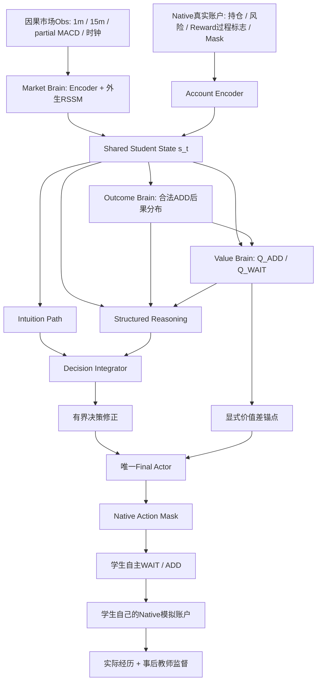

# FG-S3 Thinking Student V1 — 学生大脑架构冻结版（A1–A6）

> **日期：2026-10-22**  
> **状态：V1 核心设计基线冻结；尚未宣称代码实现或训练效果已验证。**  
> **定位：大脑的能力、信息接口、学习目标、梯度权限及训练生命周期的权威设计基线。不是Codex任务书。**  
> **上位构想：** `FG_S3_Thinking_Trading_Student_Verified_Counterfactual_Curriculum_Concept_V1_20261022.md`。本文件是其后经过A1–A6深入推导得到的**学生大脑V1实现目标**，不覆盖上位研究构想或历史课程决定。

## 0. 冻结范围与非目标

**冻结的是逻辑架构和能力闭环，不是网络隐藏维度、训练步数、学习率、文件格式及收益指标。**

- 必须是一名**完整学生**：市场认知 → 账户认知 → ADD后果预测 → ADD/WAIT长期价值 → 直觉与结构化思考 → 唯一WAIT/ADD动作 → 自主Native账户 → 真实后果和教师点评 → 继续学习。
- 市场是外生历史过程：在**价格接受者、无市场冲击**的当前模拟假设下，学生ADD不修改市场路径。账户依赖市场事件和动作，由唯一Native Env计算。
- 空仓合法ADD时，一次3手做空；单仓位，TP+5、SL−30；动作仍为WAIT/ADD。Quality TP Reward以现有正式合同为准，不因本架构偷偷增加WAIT奖励。
- 后验教师只在TRAIN教学侧读取合法未来；学生训练时产生的决策前向输入、离线/在线正式推理以及考试均只能使用当时可见信息和已经学习的参数。
- 不以“能盈利”“超过某指标”“100%复制Oracle”作为核心工程完整性的先决条件。
- V1不包含语言链式思考、多Actor投票、自动设计Reward、模型自修改交易规则、复杂元教师、动态推理预算、专门完整未来价格生成器。它们属于V2研究池。

## 1. 冻结的核心前向架构 A1–A5



### A1. 同一个完整学生与唯一动作出口

所有前向业务路径复用同一个 `student.policy(obs, recurrent_state, execution_mode)`；自主模拟、教师反事实续行及冻结考试不得悄悄改为「纯直觉Actor」或「纯Q argmax」。老师永远不是推理路径中的函数调用。

**V1正式目标策略 `π_k` 采用确定性 `DETERMINISTIC_MASKED_ARGMAX`**：空仓ADD合法且 `z_t > 0` 才执行ADD；否则WAIT；`z_t == 0` 时WAIT。S2学生正式自主轨迹、S3同策略反事实续行、S5独立考试使用完全相同的行动选择规则。`MaskedSoftmax([0,z_t])` 仍用于产生策略概率、教学和诊断，**不意味着正式动作按概率采样**。

训练数据采集如需随机探索，另外定义行为策略 `μ`（可为ε探索或温度采样），记录目标策略提议动作、`μ(a|s)`、实际执行动作、是否探索和策略快照身份；这类轨迹不得不经离策略处理直接当作 `Q^{π_k}` 的完整回报。S2不得为了避免全WAIT而修改Reward或强制ADD占比；可以使用类别平衡/成对示范监督并记录实际ADD行为，作为非阻断诊断。

### A2. 两个世界、两个编码器

- `market_belief m_t = MarketBrain(因果市场历史, 有效交易时间)`；市场RSSM的市场演化不以学生动作或仓位作为致因输入。
- `account_embedding c_t = AccountEncoder(Native当前账户完整决策相关快照)`；包含持仓、成交信息、风险/TP/SL位置、合法性和影响未来Reward的首次触发/累计过程状态。账户事实由Native负责，编码器不替代真实记账。
- `s_t = SharedFusion(m_t, c_t)`；保留独立m、c及合并状态，合法Mask来自Native而不是网络猜测。
- 市场记忆按行情连续性重置，不因一笔交易TP/SL平仓重置；换合约/不连续行情时必须显式处理；随机RSSM的反事实分支按共同记忆/随机源保证可比。
- 所有指标严格遵从单一决策时钟与可见时刻，尤其15分钟K线、partial MACD、当前分钟OHLC。

### A3. Outcome Brain：合法ADD后的一笔交易后果分布

- 共享Outcome表征 + **TP/SL互斥的首次终止时间竞争事件分布**；在H时仍持仓是生存状态，不是「永远不盈利」。真实历史边界不足为右删失，另记录有效性。
- 条件路径风险：MAE、早期逆行10点、首次逆行时间等；尊重首次终止事件与风险统计间的逻辑约束。
- 以官方Quality TP Reward语义预测单笔入场质量；不将单次质量当作长期行动Q。
- 输出结构化概率/分布统计以及Outcome内部表征，共同组成 `OutcomeEvidence`，进入Value与Reasoning；不需生成完整未来K线。
- 空仓ADD非法或持仓时，不伪造「立即再次ADD」的交易后果；使用有效位。持仓后续价值由Native账户和Value处理。
- TRAIN老师可在历史上从同初态模拟学生未执行的合法ADD，作为F2的反事实监督，不能混作学生真实已执行的交易。

### A4. Value Brain：策略条件的完整账户行动价值

```math
Q^{\pi}(s,a) = \mathbb{E}_{\mathcal I_t,a_t=a,\pi}\left[\sum_{k\ge0}\gamma^{T_k}\,r_{t+k}\right],\quad
\Delta Q^{\pi}(s)=Q^{\pi}(s,\mathrm{ADD})-Q^{\pi}(s,\mathrm{WAIT}).
```

其中`T_k`是从本次决策到第k次奖励事件的**累计有效交易分钟数**（`T_0=0`）；严格按照Native奖励事件时点与原合同定义。对不等间隔时间的Bellman递推采用单段间隔`gamma**delta_minutes`，不能把跨休市当作多次普通一分钟交易步。

- `WAIT`是保留账户容量与未来选择权，不等于零长期价值，不额外发明正等待奖励。
- `ADD`价值包含本次交易事件、持仓占用以及仓位释放后的后续机会，不等于F2预测的单次Quality分数。
- Value Backbone读取`SharedState + stop_gradient(OutcomeEvidence)`，输出合法Q值和`ΔQ`；无效动作不进入动作比较或对应Q监督。
- **学生Q**（在当前信息下估计的条件期望）、**Native历史路径双分支回报**（训练样本）和**L2严格Oracle后验值**（有未来优势的参考）是三种不同的对象，永不无标签合并。
- 双分支反事实从**完全相同的账户和市场状态**分别执行ADD/WAIT，此后均使用**同一冻结学生策略版本π_k**；并非执行同一后续动作序列。记录策略、模型、账户、行情、随机状态、回报窗口、终止/截断、Reward版本。
- Q与Actor互相依赖采用**冻结完整π_k → 评估Q^{π_k} → 改进Actor → 新π_{k+1} → 重新评估Q**的迭代，不要求网络神奇地在每个梯度步达到精确固定点。

### A5. Value-Anchored Dual-Path Final Actor

定义：

```math
\begin{aligned}
d_t &= f_D(s_t), \\
r_t &= f_R(s_t,\operatorname{SG}(e_t),\operatorname{SG}(q_t)),\\
\alpha_t &= \alpha_{\min}+(\alpha_{\max}-\alpha_{\min})\sigma(g_\alpha(s_t,\operatorname{SG}(e_t),\operatorname{SG}(q_t))), \quad 0<\alpha_{\min}<\alpha_{\max},\\
h_t &= \operatorname{LN}(d_t+\alpha_t W_Rr_t),\\
\Delta\widetilde Q_t &= \operatorname{clip}\left(\frac{\operatorname{SG}(Q_{ADD}-Q_{WAIT})}{\kappa_Q},-C_Q,C_Q\right),\\
z_t &= \underbrace{\beta_Q\Delta\widetilde Q_t}_{\text{价值锚点}}+\underbrace{C_D\tanh(f_H(h_t))}_{\text{有界决策修正}},\\
\pi_\theta(\cdot\mid s_t) &= \operatorname{MaskedSoftmax}([0,z_t], \mathrm{NativeActionMask}_t).
\end{aligned}
```

- 两条路径提供**特征/思考证据**，并无独立动作执行权；Value输出不是最终动作，不采用独立`argmax(Q)`。
- Q差为有界、固定正权重的决策价值锚点；直觉与Reasoning通过有界残差补充近似价值模型不能准确反映的部分。它不能凭空引入与官方Reward冲突的第二套收益函数。
- 非零门控及显式锚点只保证**代码路径可达**；不能证明模型一定学会利用Outcome或Q。保留Reasoning辅助监督与参数梯度/输入敏感性工程检查，但不强制每笔决策都因改变F2而变动。
- Actor类Loss的基础梯度**不穿过F2或Q预测器**（包括Reasoning、Gate与显式Q锚点的所有输入路径）；它们分别接受真实后果和价值监督，避免把后果概率扭成动作偏好。
- `beta_Q, alpha bounds, C_Q, C_D, kappa_Q`的取值属于实现配置，不在本文件规定具体数字；它们应有一致的单位/数值合同且在策略快照中记录。
- **价值信息只作一次明确的策略改进驱动：** V1的策略条件 Native 回报与反事实差距用于训练Q，Q通过显式锚点改进动作；同一份`ΔG_CF`不再作为Actor侧另一个偏好/对齐Loss去放大`ΔQ`。双路径残差作为合法老师示范形成的**行为先验**，不是又一套Q值估计器。
- **S2→S3的输入过渡：** S2的Q尚未训练，`Q→Reasoning`的投影/贡献初始化为零或等价中性状态，避免S3出现未经训练的随机Q特征突然改变行为先验。S3先通过显式价值锚点使用已受监督的Q；只有在S4存在独立合法示范监督时，才逐步学习Reasoning对Q上下文的使用。不得仅因Q数值改变就让未训练的随机Reasoning连接主导动作。

## 2. A6 冻结的学习机制

### 2.1 原则：先形成完整策略，后教Q，再交替改进

课程是**同一个完整参数树中不同参数组的阶段性更新**，不是构建六个互不继承的Agent。每次切换阶段都继承已学习参数、单独处理优化器状态，并记录数据/教师/Reward/策略版本来源。

| 课程 | 输入教材与反馈 | 训练参数组 | 课程产物 | 关键约束 |
|---|---|---|---|---|
| L1 基础市场/账户 | 因果市场序列、Native账户操作样本 | Market Encoder/RSSM、Account Encoder；必要的初始联合表征 | 学生状态基础 | 市场动态无学生动作因果输入；账户学的是规则状态，不替代Native事实 |
| L2 入场后果 | Native合法ADD的TP/SL/风险/质量事实，含右删失 | Outcome及其明确声明的SharedFusion适配部分 | 可预测的OutcomeEvidence | 市场与账户底层基础参数暂冻结；Loss语义尊重竞争事件与删失 |
| L3 初始自主策略 | 合法严格教师示范、自然WAIT/ADD与Outcome证据 | Intuition、Reasoning、Integrator、Final Head | 确定性正式学生策略π₀及其行为先验 | Q中性、β_Q不贡献动作；用示范Loss训练先验，不以自然样本类别占比强迫全部WAIT；不要求固定ADD率或盈利 |
| L4 策略价值 | 冻结完整π_k的Native自主账户回报、同初态ADD/WAIT反事实 | Value Backbone、Q头与目标值估计副本 | Q^{π_k}_ADD、Q^{π_k}_WAIT | 不以Oracle最优Q取代策略条件Q；不把截断当作终止 |
| L5 思考/策略改进 | 已学的行为先验、更新后的策略条件Q；必要时独立合法示范刷新先验 | Q价值锚点作用于完整Actor；只有示范/独立辅助目标才更新Reasoning、Intuition、Integrator、Final Head | 完整新策略π_{k+1} | Native回报经Q再影响动作，不额外叠加CF偏好Loss；Actor梯度不到F2/Q |
| L6 自主实习/迭代 | 自主Native账户、到期反馈、自然教材与专项补课 | 分时段重新执行L1/L2/L4/L5允许的参数更新 | 继续学习的完整学生 | 主账户不得由老师动作接管；更新时间和策略版本可追溯 |

**关键的启动环：** L3时并不是「没有Value Brain」。整个模型已经包含它，但初始`Q_ADD == Q_WAIT`（中性初始化），价值锚点暂为0。L3仍可从Outcome/市场和老师监督学会形成合法策略π₀。L4评估冻结π₀，更新Q的预测；由于Q进入正式策略前向，更新后行为会变化，因此需要**把新完整策略重新编号、收集和评估**，不能继续把原π₀标签冒充新策略真值。

### 2.2 监督与梯度权限矩阵

| Loss / 反馈源 | 主要语义 | 允许的V1基础更新 | 禁止的梯度穿透 |
|---|---|---|---|
| `L_market` | 市场因果自监督、状态动态 | Market Encoder / 市场RSSM | 不以学生交易动作改变市场演化，不以教师未来作为前向输入 |
| `L_account` | Native账户状态/交易过程编码的辅助学习 | Account Encoder，必要时初始Fusion | 不用学习账户余额取代Native真实数值 |
| `L_outcome` | TP/SL竞争事件似然、删失、生存、风险及质量 | Outcome；明确指定时可训练Fusion适配 | 不更新Q、Actor；初期不更新Market基础 |
| `L_q_real` | 学生实际Native连续回报/有效TD目标 | Value及其目标副本训练逻辑 | 不借Q损失随意修改Outcome概率及Actor |
| `L_q_cf` | 冻结π_k下双分支合法原生回报/差距 | Value | 教师不替学生执行主账户；后验单样本不视为确定概率 |
| `L_reason` | 独立的合法L2示范/Outcome证据的辅助理解（不能直接复制`ΔQ`或`ΔG_CF`作为额外决策价值） | Structured Reasoning辅助头与共享Reasoning层 | 不修改Outcome/Q或市场基础；不将辅助头变成第二个Actor |
| `L_policy_demo` | L2动作示范，仅有效教师数据 | Intuition / Reasoning / Gate / Integrator / Final Head | 不以Oracle Q覆盖学生Q；不经Actor损失扭曲Outcome/Q |
| **V1不启用Actor侧`L_policy_pref`、`L_align`或未定义的直接`L_policy_rl`** | CF比较只监督Q，学生自主回报经`L_q_real`更新Q，再由价值锚点改变完整Actor行为 | 不新增直接决策Loss | 避免同一价值信号在Q与残差中反复强化；未来若研究独立Actor-Critic，另立明确算法合同 |

**SG规则：** 基础V1中，Value读取的Outcome、Reasoning读取的Outcome/Q、Final Head的Q锚点对策略损失使用`stop_gradient`。这是一项**按Loss来源定义的梯度边界**，并不冻结Outcome与Q自身的监督训练，也不禁止共享市场表征在明确的L1刷新周期内更新。

**保留有限联合适配而不隐性漂移：** V1不采用所有损失同时无约束更新全部网络。若后续自主实践加入新的市场数据，可以在明确的L1校准阶段更新Market基础，再依次刷新Outcome、Q以及决策所依赖的表征，并发布新的完整策略版本。是否开放某个端到端梯度通路属于未来版本变更，不能在V1实现中暗中开启。

### 2.3 Loss的语义，不在此锁定超参数

- **Outcome：** 事件类型与首次触达时间的负对数似然；右删失使用「截止观察时仍存活」概率，路径风险与Quality按Native统计和有效位监督。不能简单把“未观察到TP”标成SL。
- **Q：** 合法且版本匹配的Native回报/TD目标，外加双分支`Q_ADD-Q_WAIT`与`G_ADD-G_WAIT`的成对监督。后验回报是单条历史样本，不是无噪声真值。
- **Reasoning：** 用合法的老师示范/Outcome证据训练辅助理解能力，输出只作教学/诊断；不以同一`ΔG_CF`再次监督一个复制Q差的隐含价值头，也不作为第二个执行Actor。
- **Final Actor：** L3使用`L_policy_demo`训练有界直觉/思考残差，形成行为先验。L4/L5的原生经验与合法CF先训练Q，再借由`β_Q·ΔQ̃`更新完整决策；在没有独立新增的示范信号时，**不强制为了更新Actor参数而增加第二份价值偏好Loss**。若需要刷新行为先验，使用独立L2示范，并在先验训练视图中中性化Q锚点，避免把Q信号反向学入残差。Q在Reasoning中仅作为停止梯度的决策上下文，不得新增`sign(ΔQ)`的残差监督。
- **策略改进：** 基础V1只有一条价值驱动改进通路`学生Native经验/有效CF → Q^{π_k} → ΔQ锚点 → 新完整π_{k+1}`。`β_Q`在π₀建立时无有效Q贡献，Q拥有合法监督以后渐进开启；每次Q/系数或残差改变而影响动作，均产生新的完整策略快照并在下一轮重评Q。这里不宣称每轮数学上严格单调改进。
- **权重原则：** 首批实施所有**保留在V1合同中的**监督通路均应能执行并更新授权参数；权重数值留给训练配置。不得以「待证明提升盈利」为由永久省略F2→Value/Reasoning→Actor的前向链路。

### 2.4 策略版本、行动价值和反事实回放

- 完整策略快照包含**全部会改变动作的参数、统计、RSSM状态初始化方案、Q参数、F2参数、行动选择模式、Reward版本、模型/Corpus/Teacher来源**；不能只冻结Final Head。
- 冻结π_k并记录实际行动前的市场belief快照、Native账户、决策时钟及动作Mask；两分支只改变首个合法动作，其余使用相同冻结策略**函数**，各自维护自己的账户状态。随机动作需记录或配对随机源。
- `Q^{π_k}`的标签和TD bootstrap使用相容的冻结目标价值/策略版本；L5改进后生成新π_{k+1}，随后重新评价。Q随策略变化可能暂时过时，不要求单个循环精确收敛，只要求**版本语义始终诚实**。
- 学生主账户如采用探索采样，必须记录**提议策略、实际行为策略和执行动作**。若采集行为并不服从目标π_k，不得把其整段回报直接冒充`Q^{π_k}`的无偏样本；需使用匹配的策略轨迹、明确定义的off-policy校正/价值估计或对该标签弃权。P0–P4等其他行为教材可广泛训练F1/F2，但不能不经语义处理直接作π_k的MC价值真值。
- 时间步为有效市场分钟；真实金融成交/持仓、奖励发生点、MarketClock、休市时间、日/合约边界必须沿用Native的权威语义。
- 数据终止（真实账户结束）与数据截断（未来不足、训练序列窗口结束）不同。没有合法未来/可信bootstrap时不制造0终值；未完成交易和过长持仓应继续保留其状态和机会成本，不因质量奖励>480分钟减弱就假定自动释放仓位。

### 2.5 两种教学时序与四类数据来源

**离线历史教材：** TRAIN区间完整后缀已存在，老师可以生成后验事实用于监督；但教师未来不能作为模型前向Obs。考试封存区间不得混入训练。

**时间顺序自主实习：** 学生当前推进到t，只能使用到t时刻已发生且有效的事实反馈执行参数更新；历史上尚未推进到的结果不可提前通过标签更新参数。若开始实习前已离线学过同段未来，不能再宣称在该段历史上做了严格的未知未来在线考试。

训练经验标记至少区分：`NATURAL_CORPUS`、`STUDENT_EXECUTED_NATIVE`、`VERIFIED_CF_NATIVE`、`HINDSIGHT_ORACLE_TEACHING`；若使用WM想象，则另标`MODEL_IMAGINED`，不能伪装为真实Native成交或已发生金融Reward。**如果复用Dreamer的想象Actor训练，想象端也必须调用相同的完整Decision Policy；市场潜在状态的想象不等于已生成足以让Native精确结算的OHLC/成交事件，禁止拿无法核验的想象收益冒充官方原生Reward。**

### 2.6 自主实习中的完整反馈闭环

1. 学生在当前因果Obs和本人账户下预测Outcome、Q、思考特征与动作分布。
2. 记录**模型版本、决策前预测、提议动作、探索/采样与实际执行动作**。
3. 主账户严格执行学生被采样/选出的合法动作；真实Native账户承担后果。
4. 到了合法反馈时间，再计算真实结果；老师可在相同决策前状态派生ADD/WAIT反事实，但不得覆盖主账户。
5. 不同类型反馈分别进入`L_outcome/L_q_real/L_q_cf/L_reason/L_policy_demo`等现行V1目标，保留有效位、Reward来源和时间条件；CF偏好不再单独给Actor增加第二份Loss。
6. 自主经验识别学生薄弱点，形成专项补课，同时维持自然教材覆盖；反事实/错题不能被冒充为自然市场概率分布。
7. 阶段性冻结整个学生，调用**相同完整政策前向**进入Teacher-free原生考试。考试只看学生独立交易；不要求测试盈利才能认定工程接线完成。

## 3. A1–A6 整体反向Review

| 审查问题 | 发现 | V1架构修订或冻结约束 |
|---|---|---|
| R01 学生ADD能否影响市场世界？ | 旧RSSM常用action条件转移，容易污染外生价格模型 | 市场RSSM禁止把学生动作作为市场价格演化因果输入；动作只影响Native账户 |
| R02 账户输入是否足够？ | 仅当前仓位/浮亏可能遗漏Reward首次触发、累计状态 | Account Encoder输入的Native决策状态必须包括所有影响未来合法性与Reward的必要过程字段 |
| R03 Market信念与账户Episode会否错重置？ | 平仓不是行情终止；随机RSSM采样会破坏分支可比性 | 市场按行情连续性重置；同态比较共享信念/记录随机状态 |
| R04 Outcome是否逻辑矛盾？ | 独立TP/SL、MAE头会预测互斥事件冲突 | 竞争事件时间分布 + 条件风险 + 删失/有效性协议 |
| R05 F2质量与Q是否重复计分？ | 单次入场质量并非长期策略价值；重复风险扣分会双算 | F2负责事实后果；Q在统一Reward下评估完整账户；Reasoning只作有界证据修正 |
| R06 Q是否成了后验Oracle？ | 最优未来策略和冻结学生策略语义不同 | 策略条件Q与严格Oracle值独立，CF使用同一个冻结学生后续策略 |
| R07 Q与Actor谁先训练？ | Actor依赖Q而Q又依赖Actor，存在启动循环 | 完整模型先建立中性Q差的π₀，冻结快照评价Q，再改进策略 |
| R08 Q如何处理长时占仓？ | 窗口结束若被错当终局，WAIT/ADD比较严重偏差 | 区分交易终止/右删失/数据截断，合法bootstrap或无效，不虚构收益 |
| R09 Reasoning可能完全无贡献？ | 非零门控/显式Q接线不保证真正学会用F2 | Reasoning使用合法L2示范/Outcome独立辅助监督 + 最小连通性检查；不因这一点增加CF价值重复Loss |
| R10 决策Loss可能破坏事实预测？ | Actor可能为实现动作目标扭曲F2概率、Q数值 | Gate/Reasoning/价值锚点全路径按Loss设SG边界，F2/Q由独立监督更新 |
| R11 Actor是否只依赖Q argmax？ | 完美Q可贪心，但现实近似Q有误差 | Q显式有界锚点 + 直觉/思考有界修正 + 唯一最终Actor |
| R12 Teacher是否接管学生真实账户？ | 会破坏自身经验与Q政策归属 | 实习主账户Teacher-free执行；老师仅事后合法分支/反馈 |
| R13 是否可能用未来参数提前考试？ | 训练标签发布与模拟实习时间不一致会隐式泄漏 | 区分离线全TRAIN和严格按时间实习；TEST封存；在参数更新日志中保留合法反馈时刻 |
| R14 训练/模拟/考试是否使用相同大脑？ | 旧F3/在线/Exam曾可能走不同路径 | 唯一`student.policy`，完整F2/Q/Reasoning/Final同前向；考试不关闭学生知识模块 |
| R15 是否为了稳定工程而永久砍掉核心？ | 工程安全门与策略效果容易被混为一谈 | 所有核心前向/监督/迭代路径必须能实际执行；不以收益或试验排名阻止工程完整性 |
| R16 Q版本是否可与F2/Actor版本不一致？ | 冻结Actor Head但让Q/F2变化，政策不再是同一π_k | 冻结完整推理依赖快照；更新任一影响动作的参数即升级完整Policy Version |
| R17 梯度矩阵会否让Account没有学习？ | 如果账户编码随机初始化后全阶段冻结则无法理解账户 | L1必须有明确账户辅助目标/监督，或声明在L2基础联合阶段更新Account；不能仅形式上创建Encoder |
| R18 真实模拟轨迹与反事实轨迹能否混进RL？ | 会把未执行动作误记为学生自己的on-policy收益 | 按来源和行为策略记录，CF可用于有依据的Value/监督或明确的off-policy训练，不能不加修正地当作本人on-policy经验 |
| R19 有探索或多策略教材时Q的目标是否有效？ | 经验来自行为策略μ，却按冻结π_k的后续价值给标签，会发生off-policy偏差 | 只有与π_k连续执行语义匹配的完整回报才可作为直接Q样本；其它须校正或不作直接Q真值 |
| R20 Dreamer想象是否绕过学生思考或金融真相？ | 旧想象分布可能只调用裸Actor，潜在模型也未必能精确Native结算 | 想象如启用须复用完整Policy；模拟收益明确为MODEL_IMAGINED，不可标成VERIFIED_CF_NATIVE |

**结论：** 在上述R01–R20约束下，A1–A6在*设计层面*形成信息流和梯度流的完整闭环。未声称训练数值稳定、所有样本都可学习、交易表现良好或当前gy30/d330已实现该架构。

## 4. V1核心冻结决议

### 4.1 冻结为V1一级合同的内容

1. 市场与账户两个世界因果分离，并由共享状态显式融合。
2. 一个完整学生、一个正式决策前向、一个合法动作出口。
3. Outcome使用统一时间-终止风险语义，提供可验证的交易后果预测。
4. Value学习策略条件的完整账户行动价值，不是只看单笔Quality或后验Oracle。
5. 决策采取**直觉 + 结构化思考 + 显式ΔQ锚点 + 有界修正**，唯一Final Actor执行。
6. L1→L2→L3示范行为先验/确定性π₀→L4冻结策略价值→L5由价值锚点改进策略→L6自主循环，始终连续继承同一个学生。
7. Outcome/Q各自监督真实语义，Actor基础Loss与事实预测梯度隔离；阶段性可重新训练前置表征并刷新下游。
8. 学生真正拥有主账户；老师未来仅作为TRAIN事后教学，反事实从相同决策状态复制。
9. 策略版本、反馈可用时间、Reward版本、数据来源和合法性必须可追溯。
10. 独立考试使用完整学生；工程完成以闭环和正确性为准，不以盈利作为前置条件。

### 4.2 不属于核心架构变更的实现自由度

网络维度/深度，分布参数化的具体层数，时间桶划分，优化器/学习率，批量与采样配比，目标网络更新频率，具体Loss权重、Replay物理格式、存储压缩、性能优化，以及在保持信息/梯度合同的前提下的组件技术选择。

### 4.3 若要变更冻结核心，应新建决策记录

如由双路径变为纯Q控制、更改Q成Oracle最优回报、更改学生动作空间/Reward、把F2关掉、在自主交易中让老师覆盖动作，均为V1核心变更。应当作为带理由的新版架构决策，而不是实现时的隐性开关。

## 5. 冻结后下一步，不在本文展开外围细节

- **B1 教学事件合同：** 老师真实结果、同状态反事实、严格Oracle、学生预测误差、延迟发布时间如何组成一题；先确认语义与消费方。
- **B2 完整课程运行协议：** 一名学生如何在教材、自采、教师点评之间连续学习，如何恢复和独立考试；不重写本文件的大脑。
- **C 工程映射：** 基于既有Gym+Dreamer底座，逐模块复用/替换，验证完整前向、每项有效Loss参数更新、Native双分支同态、不同训练模式和考试前向一致；保留证据。

**冻结声明：Thinking Student V1的核心设计已确定；后续任何新想法先入V2研究池。V1的工程实现和训练效果尚待执行与验证。**
