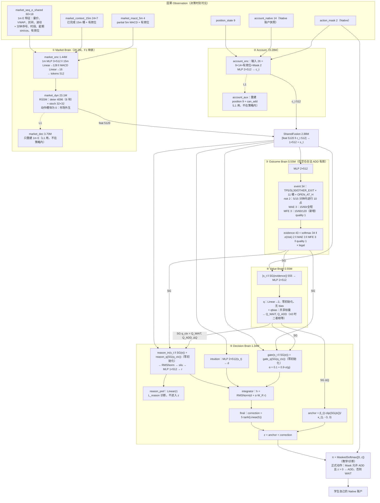
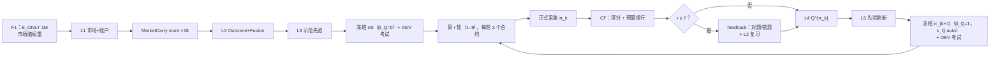

# Thinking Student V1：按代码画出的学生大脑，并与 A1–A6 设计大脑对比（2026-10-28）

> **依据：** 代码以 `feat/thinking-student-v1-20261022` 上的分档教材提交为准：dreamerv3 `4221bfa`，gym `7d5e6af`（`dreamerv3/thinking_student/` 的 `student.py`、`brain.py`、`market.py`、`labels.py`、`formal_train.py`）。参数形状和数量取自这次提交的 1x 训练（size50m）的第一个 checkpoint `FORMAL_V1_GRADED_20261028/foundation/ckpt/000000001000/agent.pkl`，与 GPU 烟测策略 `gpu_smoke/pi_smoke` 逐模块相同。
>
> **设计基线：** `~/Documents/work/research/thinkstudent/FG_S3_Thinking_Student_V1_Brain_Architecture_A1_A6_Frozen_20261022.md`（A1–A6 冻结版），以及 `brain.md` 中“V1 学生大脑：五个核心部分”一节。
>
> **范围：** 只描述代码里实际存在的前向、损失、梯度边界和课程，不评价训练效果。

## 1. 前向结构

`StudentModel.policy` 是唯一的决策入口。训练、自主采集、CF 续行和考试都调用它。下图中的维度都是 size50m 的实际值：preset 把所有 `units` 设成 512，覆盖了 `student.yaml` 里的 1024。



**参数量（size50m，不含优化器状态）：**

| 模块（参数前缀） | 参数组 | 参数量 | 在冻结策略中 |
|---|---|---:|---|
| `market_enc` | market | 1,438,400 | 是 |
| `market_dyn` | market | 23,098,368 | 是 |
| `market_dec` | market | 3,702,840 | 否（只服务 L1 重建） |
| `account_enc` | account | 277,504 | 是 |
| `account_aux` | account | 5,130 | 否（只服务 L_account） |
| `fusion` | fusion | 2,884,608 | 是 |
| `outcome` | outcome | 548,395 | 是 |
| `value` | value | 549,378 | 是 |
| `decision` | decision | 1,340,465 | 是 |
| **合计** | | **33,845,088** | 策略约 30.1M |

每个阶段各有一个优化器（`opt_l1`–`opt_l4`），各自保存状态；L5 复用 `opt_l3`。这四个优化器在初始化时都会创建，所以所有 checkpoint 的参数树相同。

## 2. 决策公式（代码原样）

```text
x        = [s_t ‖ SG(e_t)]                        e_t：43 维 evidence
q_ctx    = [SG(Q_WAIT), SG(Q_ADD), SG(ΔQ)]        ΔQ 在非合法 ADD 时为 0
d        = Intuition(s_t)
r        = ReasonMLP(silu(RMSNorm(W_in x + W_q q_ctx)))       W_q 零初始化
α        = 0.1 + 0.9·σ(w_g·x + w_gq·q_ctx)                    w_gq 零初始化
h        = RMSNorm(d + α·W_R r)
correction = C_D·tanh(w_f·h),  C_D = 5
anchor   = β_Q·clip(ΔQ/κ_Q, −C_Q, C_Q),  C_Q = 3
z        = anchor + correction
π(·|s)   = MaskedSoftmax([0, z], NativeMask)
a_formal = ADD ⇔ Mask[ADD] ∧ z > 0                  （z = 0 → WAIT）
```

- π0：`β_Q = 0`，Q 头零初始化，所以 `Q_ADD == Q_WAIT`，锚点为 0。
- π_{k+1}：冻结时 `β_Q = 1`，`κ_Q = auto`，即本轮有效训练对 ΔG 的合并标准差，下限 0.05。有效对少于 2 个时，β_Q 取 0（`Q_ANCHOR_NOT_READY`）。
- 行为策略 μ（`mode='explore'`）：以 ε = 0.05 均匀选一个合法动作，并记录 `proposed`、`mu_prob`、`explored`。正式采集、CF 续行和考试都使用 `mode='policy'`，也就是确定性的 π_k。

## 3. 课程、损失与梯度边界

| 阶段 | 命令 | 教材 / 监督 | 损失 | 更新的参数组 | 输入梯度边界 | 1x / 10x 预算 |
|---|---|---|---|---|---|---|
| L1 | `train-market` | 18 个 TRAIN 合约，P0–P4 行为账户，零 carry 窗口 | `L_market`：dyn 1.0、rep 0.1、1m E 重建 1.0；`L_account`：position MSE + can_add BCE | market、account | 下游只用 SG 输入跑诊断 | 10k / 100k |
| carry | `market-carry` | L1 市场脑在每个合约连续行情上的因果 carry | — | — | — | 18 个 store |
| L2 | `train-outcome` | facts（Native“现在 ADD 后持有”）+ graded 的 MFE；只用 P0 行 | `L_outcome`：34 类竞争事件 NLL（含删失）、risk BCE、MAE/MFE/quality MSE | outcome + fusion（`l2_fusion: true`） | market、account 输出均为 SG | 12k / 120k |
| L3 | `train-policy` | 分档教师示范：GOOD+ → ADD，POOR → WAIT，FAIR 无标签；只用 P0 行；类别平衡 | `L_policy_demo`（教学视图 `[0, correction]`，锚点中性）+ `L_reason`（reason_pref 对示范动作的 BCE） | decision | s_t 为 SG；e、q 本来就是 SG | 12k / 120k |
| 冻结 π0 | `freeze` | — | — | — | β_Q = 0 | DEV FG409 考试 |
| L4 | `train-value` | π_k 在本轮 3 个合约上的正式采集 + CF（先探针 64 步，按预算续行，之后耦合或到真实终点） | `L_q_real`（执行动作的完整 Native 回报）、`L_q_cf`（另一分支回报）、`L_q_pair`（ΔQ 对 ΔG） | value | s_t 为 SG | 500 / 1500 |
| L5 | `train-policy` | 同 L3：分档示范刷新先验 | 同 L3 | decision | 同 L3 | 100 / 1000 |
| L6（第 7 轮起） | 依次 feedback、L2 复习、L4、L5 | π_k 的答卷与本轮 CF 生成的对题和错题 | L2 复习用 `L_outcome`；L4 给决策对题 4 倍采样权重；L5 每个 batch 有 1/4 是对题窗口 | outcome + fusion、value、decision | 同各阶段 | L2 复习 200 / 2000 |
| 冻结 π_{k+1} | `freeze` | — | — | — | β_Q = 1，κ_Q = auto | DEV FG409 考试 |

几个代码层面的事实：

- **回报：** Q 目标是从分叉点开始、由同一冻结 π_k 续行得到的完整 Native 回报。γ = 332/333 每市场分钟，Reward 为 `FG_SINGLE3_REWARD_MARKET_MINUTE_TP_QUALITY_V1`。没有 bootstrap，因此也没有目标网络副本。
- **窗口：** L2–L5 的窗口从 MarketCarry store 保存的因果市场 carry 开始，所以 burn-in 为 0。L1 用零 carry 窗口训练市场脑本身。
- **教材账户：** L2 和 L3 只采样 `LABEL_ACCOUNT` = P0 的行，也就是空仓、资金充足、ADD 合法、非终止的行，facts 和示范只挂在这些行上。
- **L6 只有离线模式：** `OFFLINE_TRAIN`，TRAIN 反馈不看 `ready_at` 一律发布，并记为 `TIME_ORDERED_NOT_SUPPORTED`。CF 覆盖不具代表性的轮次（配置为 representative 时）不使用决策反馈。



## 4. 与 A1–A6 设计大脑的逐项对比

状态说明：**一致**＝代码实现了设计的语义；**细化**＝设计留给实现的部分，代码给出了具体做法；**扩展**＝在设计之上新增，且没有违反冻结合同；**偏离**＝与设计文字不同，后面给出来源；**未实现**＝设计中有、代码中没有。

### 4.1 前向（A1–A5）

| 设计条目 | 代码 | 状态 | 说明 / 来源 |
|---|---|---|---|
| A1 一个完整学生，唯一入口 `student.policy` | `StudentModel.policy`，训练、采集、CF、考试共用 | 一致 | |
| A1 正式 π_k = `DETERMINISTIC_MASKED_ARGMAX`，z = 0 时 WAIT | `brain.formal_action` | 一致 | |
| A1 探索 μ 单独定义，记录提议、μ(a\|s)、执行动作和探索标志 | `mode='explore'`：ε = 0.05 均匀合法动作 | 一致 | 正式流程只用 `policy` 模式 |
| A2 市场 RSSM 不以学生动作为因果输入 | `MarketRSSM` 的动作槽恒为零向量 | 一致 | 保留 F1 的参数形状，以便继承 |
| A2 市场 Obs：1m / 15m / partial MACD / 时钟 | 1m E 60×18（含分钟序号、时段、星期 sin/cos）、15m 24×7、5m MACD 4 | 一致 | 时钟以 1m 特征的形式进入，没有单独的时钟通道 |
| A2 Account Encoder 读完整 Native 决策快照 | 26 维：position 9 + account_native 14（含 TP/SL 距离、首次逆行标志、跨日、截止时间、资金和保证金覆盖）+ 有效位 + Mask | 一致 | R3（2026-10-23）由 10 维扩到 14 维 |
| A2 `s_t = SharedFusion(m_t, c_t)`，保留独立的 m、c 与合并状态 | `think()` 返回 account 和 state，但下游各头只读 s_t | 细化 | m、c 没有单独送给下游，只能经 s_t 间接使用 |
| A2 市场记忆按行情连续性重置，不因平仓重置 | `is_first` 只在行情起点为真；`chunk_steps = 0`（R4）；L2–L5 窗口从因果 carry 开始 | 一致 | carry 窗口来自 C4 |
| A3 TP/SL 互斥的首次终止竞争事件，H 时仍持仓为生存，右删失单独处理 | 34 类：TP5 / SL30 / OTHER_EXIT 各 11 个时间桶（5…2760 市场分钟）+ OPEN_AT_H；删失允许删失时刻之后的全部类别 | 扩展 | R2（2026-10-23）加入 OTHER_EXIT（主力换月、到期、追保），设计只写了 TP/SL |
| A3 条件路径风险：MAE、早期逆行 10 点、首次逆行时间 | risk 2（5/15 分钟内逆行 10 点）、MAE 3（15/60/全程） | 未实现（部分） | 没有“首次逆行时间”头 |
| A3（新） 有利空间 | MFE 3：成交后 15/60/120 分钟内可成交的最大有利移动，截至官方交易日末 | 扩展 | 2026-10-28 用户决定加入并放进 evidence |
| A3 以 Quality TP 语义预测单笔质量，不当作 Q | quality 1：整笔交易的官方 Quality 奖励（MSE） | 一致 | |
| A3 `OutcomeEvidence` = 结构化统计 **+ Outcome 内部表征** | evidence 43 只含受监督的答案，没有 Outcome 隐层 | 偏离 | R5（2026-10-23）把未受监督的 32 维 latent 移出了 evidence |
| A3 非法 ADD 或持仓时不伪造 Outcome | evidence 和全部答案乘以 `legal`（空仓且 ADD 合法） | 一致 | |
| A4 Value 读 `SharedState + SG(OutcomeEvidence)`，输出 Q_ADD、Q_WAIT | `ValueBrain([s_t ‖ SG(e)])` | 一致 | |
| A4 π0 时 Q 中性 | q 核零初始化、无 bias，加共享 qbias | 一致 | |
| A5 两条路径 + 门控 + 有界修正 + 显式 ΔQ 锚点，唯一 Final Actor | 见第 2 节公式，与 A5 逐项对应 | 一致 | LN 实现为 RMSNorm；α_min = 0.1、α_max = 1、C_D = 5、C_Q = 3 属于配置 |
| A5 Reasoning 和 Gate 只读 SG(e)、SG(q)；锚点用 SG(ΔQ) | `sg(evidence)`、`sg(q)` | 一致 | |
| A5 S2→S3：Q→Reasoning 的投影初始为零 | `reason_q`、`gate_q` 零初始化且无 bias | 一致 | |
| A5 Reasoning 辅助头不是第二个 Actor | `reason_pref` 只受 L_reason 训练，不进入 z | 一致 | |

### 4.2 学习机制（A6）

| 设计条目 | 代码 | 状态 | 说明 / 来源 |
|---|---|---|---|
| 同一参数树、分阶段更新参数组、每阶段单独的优化器状态 | `GROUPS` / `stage_groups`，`opt_l1`–`opt_l4` | 一致 | |
| L1：市场 + 账户，“必要的初始联合表征” | market + account；Fusion 不在 L1 训练 | 细化 | Fusion 在 L2 声明后才训练 |
| L2：Outcome 加明确声明的 Fusion 适配，市场和账户冻结 | `l2_fusion: true`；market、account 输出为 SG | 一致 | |
| L3：**合法严格教师示范**，Q 中性，β_Q 不贡献动作 | **分档教师**示范（GOOD+ → ADD、POOR → WAIT、FAIR 无标签）；教学视图 `[0, correction]` | 偏离 | 2026-10-28 用户决定：分档教师是唯一的 L3/L5 示范源，strict 只用于 P4 行为账户 |
| L4：冻结 π_k 的自主回报 + 同初态 ADD/WAIT 反事实；“目标值估计副本” | 完整 Native 回报（无 bootstrap）+ CF 续行；`q_real`、`q_cf`、`q_pair` | 细化 | 目标是完整 MC 回报，所以不需要目标副本。CF 用探针、预算和耦合截断长分支（Astra CF，2026-10-27），预算外的分叉记为 UNAVAILABLE_BUDGET，没有标签 |
| L4 不把截断当终止，不制造 0 终值 | 未完成的分支不给标签；覆盖率低于 0.8 时记为 exploratory | 一致 | 1x/10x 配置为 `cf_coverage: exploratory` |
| L5：Q 经锚点改进 Actor；示范只在必要时刷新先验 | 冻结时设 β_Q = 1、κ_Q auto；L5 用分档示范刷新先验（教学视图中锚点中性） | 一致 | |
| 不启用 Actor 侧 `L_policy_pref`、`L_align`、`L_policy_rl` | 没有这些损失 | 一致 | |
| SG 规则：Actor 损失不穿过 F2 和 Q | L3 的 `think(..., stop_state=True)` 加上 opt_l3 只含 decision 组 | 一致 | |
| L6：自主实习（时间顺序）+ 离线；专项补课，同时保持自然教材覆盖 | 只有 `OFFLINE_TRAIN`；错题集（默认关）和**正确集**（默认开）：L2 复习和 L5 的每个 batch 有 1/4 是对题窗口，L4 给决策对题 4 倍权重，其余为自然窗口 | 偏离 + 扩展 | 不支持严格时间顺序（`TIME_ORDERED_NOT_SUPPORTED`）。正确集由用户于 2026-10-28 提出（“加深做对”）。E-7 风险：固定份额会改变自然分布，且结果对题大多是 TP，需要拿第 7 轮和第 1 轮比较 |
| L6 中可以在明确的 L1 校准后依次刷新 Outcome、Q 和决策表征 | L6 不重训 L1；L2 复习会更新 Fusion，随后 L4 重训 Value、L5 刷新 decision，最后整体冻结 | 一致 | 改变 Fusion 的同一轮内，下游也会依次刷新 |
| 2.5 经验来源标记（`NATURAL_CORPUS` 等四类） | 教材：`TEACHER_ADD_FACT`（facts）、`GRADED_ENTRY_TEACHER`（graded）、`EXECUTED_NATIVE` 行为账户；反馈：`STUDENT_EXECUTED_NATIVE`、`VERIFIED_CF_NATIVE`、`HINDSIGHT_GRADED_TEACHING` | 细化 | 名称不同，按来源分得更细；`HINDSIGHT_ORACLE_TEACHING` 换成了分档教师，严格 Oracle 不再提供训练示范 |
| 2.5 Dreamer 想象如果启用，必须调用完整策略 | 不使用想象训练 | 一致 | `MarketRSSM.imagine` 存在，但没有调用方 |
| 2.4 完整策略快照（全部影响动作的参数、模式、Reward、教材来源） | `freeze`：agent.pkl 保存全部参数；policy.json 记录 ts 配置、锚点、教材（含分档阈值）和谱系 | 一致 | |

### 4.3 汇总

- 代码完整实现了五个核心部分（Market、Account、Outcome、Value、Decision），以及 A5 的价值锚点双路径决策。所有 SG 边界和各阶段的参数组权限都与 A6 2.2 的矩阵一致。
- 偏离冻结文字的只有三处，每处都有记录在案的决定：
  1. evidence 不含 Outcome 隐层（R5）；
  2. L3/L5 的示范改用分档教师（2026-10-28）；
  3. L6 只有离线模式，并加入了正确集。
- 设计之上的扩展有三项：OTHER_EXIT 与 OPEN_AT_H 类别（R2）、MFE 头（2026-10-28）、CF 的探针与预算截断（2026-10-27）。
- 设计中有、代码中没有的：“首次逆行时间”风险头，以及严格时间顺序的自主实习。两者都没有阻断当前训练。

## 5. 训练中值得留意的结构性问题

1. **L6 的 L2 复习会更新 Fusion。** Fusion 是 Value 和 Decision 共同的输入。同一轮内 L4、L5 随后都会刷新，所以冻结出的 π_{k+1} 是自洽的，但 L4 的 Q 是在新的 s_t 上拟合的。如果第 7 轮起 Q 的留出误差明显变差，可以先检查这一点。
2. **evidence 没有隐层。** Value 和 Reasoning 只能读到 43 个答案。这两部分能用的 Outcome 信息，以 Outcome 头学会的东西为上限。
3. **示范只挂在 P0 行。** P1–P4 行为账户的行（包括持仓中的行）只用于 L1。持仓期间的决策已由 Native Mask 固定为 WAIT，因此对动作没有影响。
4. **MFE 窗口不因出场截断：** SL 后的有利空间仍计入。它预测的是“这个入场点之后行情给出的空间”，不是“这笔交易拿到的空间”。
