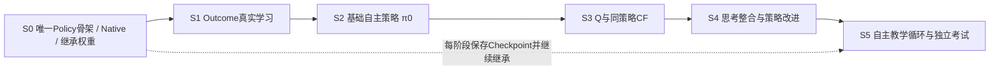

# FG-S3 Thinking Student V1 — C3实施里程碑、最小验收与反向Review

> 日期：2026-10-22  
> 状态：**工程实施方案（设计已Review，尚未执行）**；**不是Codex开发任务书、也不是已完成验收报告**。  
> 设计依据：`FG_S3_Thinking_Student_V1_Brain_Architecture_A1_A6_Frozen_20261022.md`（冻结能力合同）；B1老师教学协议、B2课程原则、C1三链数据流及 `FG_S3_Thinking_Student_V1_C2_Engineering_Redesign_No_Legacy_Compatibility_20261022.md`（优先适用的工程取舍）。

## 0. 工程总目标与不能变的约束

**第一版交付目标：** 同一个学生，使用因果市场与Native账户形成认知，预测合法ADD后果，学习Q_ADD/Q_WAIT，通过直觉+结构化思考+价值锚点输出唯一WAIT/ADD；自己的主账户产生经历；老师基于TRAIN未来提供独立、可验证教学；学生得到合法梯度更新后继续自主运行并参加Teacher-free考试。

**工程原则：**

1. Gym与DreamerV3都只是可自由修改的底座；**两个仓库均不维护旧S3功能兼容**。保留有用的金融规则、行情读取、训练张量、原生回放等，阻碍新设计的旧Stage/Gate/API可以直接替换。
2. **开发时就训练，训练时继续开发。** 每个纵向里程碑交付一段实际可运行、可学习的功能；记录有用Checkpoint并在下一阶段默认继承，不等完整系统才首次训练。
3. **Checkpoint和教材默认沿用**，不以代码Hash/Git SHA/模型或教材版本签名拒绝启动。真实结构或标签语义变化由开发人员人工修正加载、选择性继承或补算标签；不允许假恢复或错误重解释。
4. 保留反事实所必需的**完整冻结策略π_k的语义身份**：这不是源码Hash，更不是新型启动Gate。冻结用于Q^{π_k}的教学定义和可复现性。
5. 只验证关键风险（因果未来、账户成交、合法同策略CF、训练梯度及参数继承、Teacher-free完整执行）。**不建审计/准入/证书工业**；效果指标仅用于后续研究，不作为建设模块的前置条件。
6. 不修改冻结的大脑交易目标：单仓位、每次ADD做空3手、TP+5、SL−30、WAIT/ADD、Quality TP；不自行新增等待奖励或旧功能兼容目标。

## 1. 结构先立、能力递进：S0–S5的统一主线

**架构骨架与功能成熟度分开：** S0就建立**一套正式Student Policy入口**，内部具备A1–A5全部能力的对象及前向连接；早期某些预测尚未训练，Q_ADD==Q_WAIT（中性启动），不能将尚未学好的输出冒充已学习能力。S1–S5逐步把监督、参数更新、教师与自主循环接入同一对象树。禁止出现「训练用新Actor / 采集用旧Actor / 考试用裸Actor」三套正式路线。

### S0 — 最小完整学生前向 + 训练底座

**先开发：**
- 将Gym因果行情、Native账户、合法Action Mask、交易推进接至**唯一**`student.policy(...)`；创建Market Brain（外生市场）、Account Encoder、Shared State、Outcome、Value、Intuition、Reasoning、Integrator、Final Actor这些必要部件，保留其冻结的前向关系。
- S0允许Outcome等参数尚未学好，但输出类型、有效性与Mask必须真实；Q两个动作值以相同中性初值启动，保留A5的显式Q锚点而不另建临时Actor。
- 选择性继承已存在F1/市场模型权重；不适合外生市场语义的旧动作条件RSSM可改造/重训，不强求兼容旧训练入口。
- 建立最朴素的Checkpoint保存与恢复、既有行情/教材读取链，能继续小规模Market/Account学习。

**真实产物：** 从一段因果行情启动完整Policy，Native账户按真实WAIT/合法ADD运行若干步，并能保存、恢复模型参数继续前向或训练。

**最小验证：** 1条端到端原生账户样例 + 1次权重保存/重载对照；检查当前分钟/15m可见性和动作Mask。**不要求预测质量或盈利。**

**停止扩张：** 不在S0开发Oracle全套、完整课程调度、分布式平台、全部考试统计和模型/教材兼容注册中心。

### S1 — Outcome Brain能够学习真实后果

**先开发：**
- 按A3建立TP/SL竞争事件时间分布、条件MAE/早期逆行、Quality和`OutcomeEvidence`；非法ADD时输出明确无效位。
- 从现有有效ADD后果事实、历史行情及Native同态回放得到监督；支持右删失、不把无观察终局伪装成SL/零收益。
- 提供`L_outcome`真实梯度更新；在Value和Reasoning的正式前向中可读取最新Outcome证据。

**真实产物：** 一次有效Outcome教学更新前后，参数确有变化，新Checkpoint携带训练后的Outcome并继续推理。

**最小验证：** 1个TP、1个SL、1个仍持仓/删失样例的时间与有效性语义；1次梯度更新。无需大型预测曲线或AUC门槛。

### S2 — 形成首个自主学生π0

**先开发：**
- 用现有严格L2示范、合法动作标签和自然WAIT/ADD行为样本训练Intuition、Reasoning基础能力、Integrator及唯一Final Actor；继续用S1已经得到的Outcome表征。
- Q差保持启动中性值直到有策略条件Q监督，避免随机Q支配初始行为；保留同一Actor最终公式。
- 接入学生自己的Native自主采集，记录事前Outcome/Q/最终动作分布、实际动作、行为策略、账户经历。老师不能替换主账户行为。
- 冻结一份**完整学生**π0，用于下一阶段的同策略反事实。

**真实产物：** π0在真实历史市场上连续自主WAIT/ADD、开平仓、保存完整参数与基本行动记录，并可在不接入教师未来的情况下恢复运行。

**最小验证：** 一段短自主回放 + 一次基础Actor梯度更新；正确执行Mask与TP/SL，不要求ADD频率或净收益达标。

### S3 — 学会策略条件Q并接入真正的反事实老师

**先开发：**
- 从同一决策前Native账户+市场状态复制两个合法分支：先ADD/先WAIT；之后都交给**同一冻结完整π0**，但因账户不同允许产生不同后续动作序列。
- 输出两条分支统一Reward/时钟/评价范围的历史回报；完整、估计尾值、不可比要明确区分，不能把截断当终止。
- 用匹配的学生连续Native经历与合法同策略CF训练`Q^{π0}(s,ADD/WAIT)`及价值差；其他P0–P4行为轨迹不得无条件作为该Q的on-policy真值。
- Value输出真实进入Structured Reasoning和A5显式ΔQ锚点；Value变化即意味着最终策略可能变化。更新后的完整学生作为**新候选π1**，下一轮Q需按新策略重新评估。

**真实产物：** 一条可复现的同初态ADD/WAIT教师比较 + 真实Q Loss与参数更新 + 新完整Policy的Q锚点生效。

**最小验证：** 极小的两分支原生回放（先选未来完整的教学案例）+ 1次价值参数更新及决策依赖检查；无需先对所有历史状态生成CF。长尾不可比样本可直接弃权，不能造标签。

### S4 — 完成Reasoning训练与学生决策改进

**先开发：**
- 实现`L_reason`合法偏好/强弱辅助监督；`L_policy_demo`、`L_policy_pref`、`L_align`，以及来自学生实际Native账户的有效`L_policy_rl`路径。不要把Oracle动作和策略条件CF Q视为同一类真值。
- 按A6梯度权限更新：Actor类损失不通过Outcome/Q输出修改其预测器；Outcome和Q保有自己的独立事实监督。
- 实现冻结π_k→评估Q^{π_k}→优化Reasoning/Actor→发布新完整π_{k+1}→下一轮重新评估的迭代。先以少量数据证明一次更新链能跑通，不用先建设复杂调度系统。
- 前向确保Outcome和Q有真实连接与可训练使用路径；不将Reasoning辅助头当第二个下单Actor。

**真实产物：** 同一学生连续完成一次教学、各自合法Loss更新、新策略发布；新权重实际参与下一次WAIT/ADD决策。

**最小验证：** 每类已纳入核心合同的Loss至少有一个有效训练样例，梯度可更新授权参数；不要求一次更新后每个动作都变化、不要求收益提升。

### S5 — 完整自主教学循环与Teacher-free考试

**先开发：**
- 完成B1教学题生命周期：事前答卷、学生真实Native经历、ADD后果、同策略CF、独立Oracle来源、有效性与成熟时间。允许部分反馈先成熟，其他反馈稍后成熟或弃权。
- 完成B2基本课程循环：自然市场+既有多行为教材+学生自主经历+教师有效反馈；保留自然教材覆盖，针对性补课为补充而非替代。
- 同一完整学生持续保存Checkpoint、恢复训练，更新后按新模型重建/初始化匹配的RSSM记忆，不复用语义已不一致的旧潜在状态。
- 在封存测试区间使用相同完整学生Policy运行Teacher-free考试；训练与考试不使用同一段未来标签，考试期间不接受老师教学更新。
- 可复用原生考试执行器和统计输出，但不需保留旧裸Actor、旧F3考试入口与旧准入Gate。

**真实产物：** 跑通「学生自主交易→老师在TRAIN给合法反馈→学生继续学习并继承权重→下一版继续交易→Teacher-free独立考试」的一次完整闭环。

**最小验证：** 一次可复现的小规模闭环演示，检查资金/账户动作、无未来泄漏、参数继承、独立考试无Teacher调用。盈利和AUC只记录，不设门槛。

## 2. 每个阶段统一的最小交付标准

**最小Done = 有新功能真实运行 + 有真实学习活动（如该阶段含学习） + 能继承已有资产 + 只针对本阶段最高风险完成一个薄验证。**

每一段开发结束只需留下：
- **运行证据**：一条实际命令与简短输出或小例子，表明新功能进入了真实执行链；
- **训练成果**：最新可用Checkpoint（不需要代码Hash身份/证书）；若是非训练阶段，则保留可继续训练的模型；
- **极短记录**：改了什么、实际完成什么、下一段从哪里继续，发现的真实阻断问题是什么。

不要求每段写一份独立验收论文、全面性能审计或多轮证书。保留现有简单单元测试，并可直接在功能测试中复用证据。

## 3. 两仓库职责和接口（逻辑约定，不锁死类名）

| 部分 | 推荐位置 | 核心职责 |
|---|---|---|
| Native市场账户/真实Reward | Gym | 唯一金融事实与执行器；价格和学生动作共同推进账户 |
| 因果市场Obs、自然/旧行为教材 | Gym（或最简单的现有组件） | 以正确语义供给学生与Learner |
| 原生ADD后果、Oracle事实 | Gym | 不进入学生实时决策 |
| 同策略CF执行 | Gym原生分支 + 注入的冻结Student Policy调用 | 双分支同初态同冻结策略，避免Gym导入整个Dreamer应用 |
| Market / Account / Outcome / Value / Reasoning / Actor | DreamerV3项目（作为代码底座） | 一个完整学生参数树、唯一Policy |
| A6 Learner、训练/Checkpoint、课程循环 | DreamerV3项目或现有最直接的训练入口 | 分目标更新、持续训练、权重发布 |

**不维护旧接口层**。如果跨仓库集成更简单，直接重构模块边界；不要为了两个仓库“看起来解耦”引入多层抽象。核心是最终只有一个Policy与一个原生账本。

## 4. 训练资产继承与修改时的具体行为

### Checkpoint
- 日常代码迭代后默认优先加载最近Checkpoint继续训练；不得因为Git SHA或代码Hash变化而拒绝启动。
- 代码重命名/参数键改变：开发人员直接修改加载器或一次性转换；网络增量增加时尽量继承已有主体权重，新模块单独初始化。
- 真正维度或参数语义不符：明确哪些权重沿用、哪些重新初始化；优化器状态可继承就继承，无法安全恢复则允许重建。**不暗中把整个模型重置成随机参数后声称成功恢复。**
- 只保存合理的最简快照/模型状态。`π_k`是用于CF的冻结策略语义，不是系统性的版本注册、Hash匹配或恢复Gate。

### 教材
- 原始行情、账户事实、已完成ADD后果和合法轨迹默认继续使用；旧字段缺少新标签时补算相应教学目标，不重新制造整份历史教材。
- 旧Quality单笔标签不得直接转成长期策略条件Q；旧Oracle后验值不得伪装成当前学生价值。
- 教材生成代码变化不自动触发数据作废。由开发人员修正读取和标签语义，不开发兼容性认证系统。
- 自主时间顺序教学的反馈成熟、TRAIN与考试区间隔离是防未来泄漏的必要规则，不是兼容审计。

## 5. 最少必要检查：只守住关键失真风险

| 检查 | 覆盖的实际风险 | 推荐最小方式 |
|---|---|---|
| V1 行情因果与Native动作 | 当前分钟、15m、MACD偷看未来；非法ADD；账户TP/SL错误 | 1段边界行情和1段原生账户烟测；复用旧金融单测 |
| V2 正式策略唯一性 | 旧裸Actor旁路；F2/Q/Reasoning只在训练时存在 | 1次完整Policy前向依赖检查，确认训练/采集/考试入口一致 |
| V3 老师CF正确性 | 两分支不同初态/不同后续策略；截断伪装完成 | 1–2个明确可比的Native样例，以及1个不可比样例 |
| V4 真正学习与恢复 | Loss无梯度、没有更新目标模块、恢复时权重静默丢失 | 每一必要学习目标1个短更新；Checkpoint重载抽查关键张量 |
| V5 Teacher-free执行 | 教师后验潜入动作、考场模型和训练模型不一致 | 1段封存行情短考，证明同Policy且无教师输入/更新 |

**V1–V5是五类功能自检，不是五个独立验收Gate或五份审计报告。** 发现真实错误立即修复；不通过表现指标设禁用F2/Q的开关。

### 禁止扩张的工作
- 不围绕代码/数据Hash建设兼容检查、签名/证书、训练准入和恢复审批。
- 不让旧F3/F4协议作为V1成功定义；旧功能无需继续工作。
- 不因AUC、Oracle模仿率、盈利、固定ADD占比未达标而阻止实现下一核心模块。
- 不在首轮端到端完成前开展多个seed、大样本滚动检验、长篇消融或十余组独立审计。
- 不为了优化理论完美性而中断一段已可运行的功能，先记录改进方向，除非发现因果、金融、目标语义等真正的正确性问题。

## 6. 进度应当如何衡量

优先使用**可运行能力的累积**：

| 里程碑 | 能力累积 |
|---|---|
| S0 | 完整前向骨架 + Native账户 + 基本Checkpoint继承 |
| S1 | S0 + 后果分布真实学习与下游读取 |
| S2 | S1 + 自主完整学生π0和主账户真实轨迹 |
| S3 | S2 + 同策略CF老师与策略条件Q学习，显式Q锚点进入动作 |
| S4 | S3 + Reasoning/Actor真实策略改进与新学生继承 |
| S5 | S4 + B2反馈成熟循环与完整学生Teacher-free考试 |

进度不可由`test数量`、`审计报告数`、`Hash检查覆盖率`或短期盈利代替。训练日志可以帮助研究，但不是实现完成的唯一证据。

**工作量预算只作为偏航提醒**：主要精力投向核心功能，必要正确性测试从简，Review用来阻止架构性返工；不以“必须完成指定百分比测试”做新门禁。出现安全或数据真实性问题时应优先修复。

## 7. 反向Review（C3完成后）

| 编号 | 风险 / 反向质疑 | 修订后的处理 |
|---|---|---|
| R1 | S0只做临时Actor，S2/S4再换一套，违反唯一Policy | **修订**：S0就实例化完整A1–A5大脑；以后只让能力逐步学会工作，Q初始中性。 |
| R2 | S1训练F2却没有正式Actor读取 | **修订**：S0固定F2→Q/Reasoning→唯一Actor前向路径，S1只增加真实监督。 |
| R3 | 在S3之前训练Q没有明确后续π | 先在S2产生冻结完整π0，再在S3使用匹配的学生Native和CF训练策略条件Q。 |
| R4 | 训练Q后策略已经变化，却继续声称仍是π0 | **修订**：Q更新后即形成新的完整候选策略；下一轮以新策略重新收集/评估。 |
| R5 | 无旧兼容会不会让已训练权重和教材全部浪费 | 重构旧程序不等于删除资产；优先继承有效权重和行情事实，语义不匹配由开发人员修正。 |
| R6 | 继续训练时新模块参数形状改变 | 允许部分参数继承和优化器重建；不做自动兼容注册/Hash门禁，也不容许假恢复。 |
| R7 | S3最先需要大量CF，拖慢核心神经网络开发 | **修订**：从极少量完整可比样例打通真实教师与Q梯度，批量CF与效率优化延后。 |
| R8 | 不完整CF尾部被当0，学生偏好错误 | 不可比标签弃权或使用语义明确的合法尾值估计；不为过审计而做近似假标签。 |
| R9 | Reasoning头有Loss但最终Actor仍可忽略它 | 检查真实调用和可更新性、必要时受控输入敏感性；不强制每一状态都有动作翻转。 |
| R10 | 把旧P0–P4行为回报当作Q^{π_k}真值 | 行为策略与目标策略不一致时不得直接作on-policy Q真值；可用于Market/Outcome或正确的离策略训练。 |
| R11 | 保留旧RSSM action-conditioned动力学破坏A2 | 市场部分实现外生路径，账户Native独立推进；旧模型权重只选择性迁移。 |
| R12 | 代码改动以后教师CF回放旧快照不可重现 | π_k仅需在生成教学时冻结可调用的完整策略；旧快照无法按新程序运行时人工决定保留旧有效标签或重算，不加代码Hash锁。 |
| R13 | 实时教学与离线教材混用未来 | 保留教学模式与ready_at语义；考试时间区间严守隔离；不开发大型数据准入仪式。 |
| R14 | 上游Market变更使下游表征失配或RSSM状态错配 | 继承参数后对下游做最简适配；必要时用新模型重建历史记忆；不无限追求旧参数逐位兼容。 |
| R15 | 为了“测试完美”再次让审计超过开发 | 各片以功能+最小证据收尾；P2效果研究推迟；没有实际问题不新增审计系统。 |
| R16 | S4未完成策略RL，就在S5声称已闭环 | S4至少有一条学生Native回报进入Actor学习的真实路径，S5再完成延迟反馈循环和独立考试。 |

**Review结论：** 六个功能纵切的依赖顺序成立，重要矛盾（唯一Actor、Q启动环、策略变化、CF尾值和Checkpoint继承）已在各阶段合同中消解。仍无法预先保证收益和训练收敛；不把效果研究当工程架构否决理由。无需修改A1–A5冻结脑结构；对A6/B1/B2/C1沿用C2的轻量工程流程修订。

## 8. C3设计冻结建议及下一步

- 建议**冻结S0–S5交付顺序、核心语义和极简完成依据**；保留模块实现细节、资源预算、训练超参数的工程自由。
- 在真正编写Codex任务书时，按**一次一个纵向切片**组织，当前切片验收就是一段可运行的功能，不拆分成成批独立审计WP。
- 每个Codex开发阶段默认保留已有模型和教材，不需要旧功能兼容、源码Hash匹配、长篇审计报告；如发现真实正确性阻断，再就地修复。
- S5首次完整闭环之后，再安排更大规模训练、多个seed、滚动样本外及择时优越性研究；它们属于效果验证，不属于本版最小工程完成条件。

**总定义：** V1第一版完成，不是代码里存在六个模块，而是「同一个学生真的能观察、预测、比较、决策、交易、接受合法反馈、更新并再次独立交易」。
