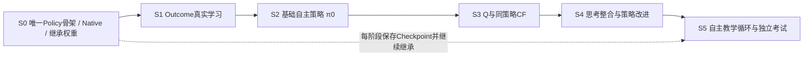

# FG-S3 Thinking Student V1 — C3实施里程碑、最小验收与反向Review

> 日期：2026-10-22  
> 状态：**工程实施方案（设计已Review，尚未执行）**；**不是Codex开发任务书、也不是已完成验收报告**。  
> 2026-10-22 教材工程补充：§5新增教学数据生产与消费合同；原S0–S5主顺序、A1–A6大脑和最少验证原则不变。  
> 设计依据：`FG_S3_Thinking_Student_V1_Brain_Architecture_A1_A6_Frozen_20261022.md`（冻结能力合同）；B1老师教学协议、B2课程原则、C1三链数据流及 `FG_S3_Thinking_Student_V1_C2_Engineering_Redesign_No_Legacy_Compatibility_20261022.md`（优先适用的工程取舍）。

## 0. 工程总目标与不能变的约束

**第一版交付目标：** 同一个学生，使用因果市场与Native账户形成认知，预测合法ADD后果，学习Q_ADD/Q_WAIT，通过直觉+结构化思考+价值锚点输出唯一WAIT/ADD；自己的主账户产生经历；老师基于TRAIN未来提供独立、可验证教学；学生得到合法梯度更新后继续自主运行并参加Teacher-free考试。

**工程原则：**

1. Gym与DreamerV3都只是可自由修改的底座；**两个仓库均不维护旧S3功能兼容**。保留有用的金融规则、行情读取、训练张量、原生回放等，阻碍新设计的旧Stage/Gate/API可以直接替换。
2. **开发时就训练，训练时继续开发。** 每个纵向里程碑交付一段实际可运行、可学习的功能；记录有用Checkpoint并在下一阶段默认继承，不等完整系统才首次训练。
3. **Checkpoint和教材默认沿用**，不以代码Hash/Git SHA/模型或教材版本签名拒绝启动。真实结构或标签语义变化由开发人员人工修正加载、选择性继承或补算标签；不允许假恢复或错误重解释。
4. 保留反事实所必需的**完整冻结策略π_k的语义身份**：这不是源码Hash，更不是新型启动Gate。冻结用于Q^{π_k}的教学定义和可复现性。
5. 只验证关键风险（因果未来、账户成交、合法同策略CF、训练梯度及参数继承、Teacher-free完整执行）。**不建审计/准入/证书工业**；效果指标仅用于后续研究，不作为建设模块的前置条件。
6. 不修改冻结的大脑交易目标：单仓位、每次ADD做空3手、TP+5、SL−30、WAIT/ADD、Quality TP；不自行新增等待奖励或旧功能兼容目标。

## 1. 结构先立、能力递进：S0–S5的统一主线

**架构骨架与功能成熟度分开：** S0就建立**一套正式Student Policy入口**，内部具备A1–A5全部能力的对象及前向连接；早期某些预测尚未训练，Q_ADD==Q_WAIT（中性启动），不能将尚未学好的输出冒充已学习能力。S1–S5逐步把监督、参数更新、教师与自主循环接入同一对象树。禁止出现「训练用新Actor / 采集用旧Actor / 考试用裸Actor」三套正式路线。



### S0 — 最小完整学生前向 + 训练底座

**先开发：**
- 将Gym因果行情、Native账户、合法Action Mask、交易推进接至**唯一**`student.policy(...)`；创建Market Brain（外生市场）、Account Encoder、Shared State、Outcome、Value、Intuition、Reasoning、Integrator、Final Actor这些必要部件，保留其冻结的前向关系。
- S0允许Outcome等参数尚未学好，但输出类型、有效性与Mask必须真实；Q两个动作值以相同中性初值启动，保留A5的显式Q锚点而不另建临时Actor。
- 选择性继承已存在F1/市场模型权重；不适合外生市场语义的旧动作条件RSSM可改造/重训，不强求兼容旧训练入口。
- 建立最朴素的Checkpoint保存与恢复、既有行情/教材读取链，能继续小规模Market/Account学习；同时建立本文件§5的**教材资产清单与按需要补标签**的最小入口。

**真实产物：** 从一段因果行情启动完整Policy，Native账户按真实WAIT/合法ADD运行若干步，并能保存、恢复模型参数继续前向或训练。

**最小验证：** 1条端到端原生账户样例 + 1次权重保存/重载对照；检查当前分钟/15m可见性和动作Mask。**不要求预测质量或盈利。**

**停止扩张：** 不在S0开发Oracle全套、完整课程调度、分布式平台、全部考试统计和模型/教材兼容注册中心。

### S1 — Outcome Brain能够学习真实后果

**先开发：**
- 按A3建立TP/SL竞争事件时间分布、条件MAE/早期逆行、Quality和`OutcomeEvidence`；非法ADD时输出明确无效位。
- 按§5的教材合同优先复用已有ADD事实，缺少TP5/SL30/OTHER_EXIT、首次事件时间、MAE/早期逆行及删失信息时只补算缺失部分；支持右删失，不把无观察终局伪装成SL/零收益。
- 提供`L_outcome`真实梯度更新；在Value和Reasoning的正式前向中可读取最新Outcome证据。

**真实产物：** 一次有效Outcome教学更新前后，参数确有变化，新Checkpoint携带训练后的Outcome并继续推理。

**最小验证：** 1个TP、1个SL、1个仍持仓/删失样例的时间与有效性语义；1次梯度更新。无需大型预测曲线或AUC门槛。

### S2 — 形成首个自主学生π0

**先开发：**
- 从现有TRAIN严格L2示范中筛选**目标与Reward口径确实一致且ADD合法**的样本；缺少示范时在TRAIN按原生规则按需生成。用这些示范训练Intuition、Reasoning基础能力、Integrator及唯一Final Actor的行为先验；可采用类别平衡/成对示范监督防止自然标签不平衡让模型丧失ADD区分能力，但不强制某个ADD比例、不增设Reward。继续用S1 Outcome表征。
- Q差保持启动中性值直到有策略条件Q监督，避免随机Q支配初始行为；保留同一Actor最终公式。 `Q→Reasoning`的未训练输入贡献也须保持中性，等S4有独立有效监督再学习使用，S3先让Q通过显式锚点生效。
- **正式π₀采用确定性Masked Argmax**：ADD合法且`z>0`时ADD，否则WAIT，平局WAIT。接入Native自主采集；探索另用行为策略`μ`，记录π₀提议、`μ(a|s)`、实际动作、探索标记、账户经历。老师不能替换主账户行为。
- 冻结一份**完整学生**π0，用于下一阶段的同策略反事实。

**真实产物：** π0在真实历史市场上连续自主WAIT/ADD、开平仓、保存完整参数与基本行动记录，并可在不接入教师未来的情况下恢复运行。

**最小验证：** 一段短自主回放 + 一次基础Actor梯度更新；检查S2正式决策与后续CF/考试约定相同、Mask与TP/SL正确，并记录ADD比例但不设门槛。

### S3 — 学会策略条件Q并接入真正的反事实老师

**先开发：**
- 从同一决策前Native账户+市场状态复制两个合法分支：先ADD/先WAIT；之后都交给**同一冻结完整π0**，但因账户不同允许产生不同后续动作序列。
- **在S3同时提供新Q教材的生产者**（§5.5）：输出两条分支统一Reward/时钟/评价范围的历史回报；完整、估计尾值、不可比要明确区分，不能把截断当终止。旧Oracle的动作或单笔Quality不允许替代策略条件Q标签。
- 用匹配的学生连续Native经历与合法同策略CF训练`Q^{π0}(s,ADD/WAIT)`及价值差；其他P0–P4行为轨迹不得无条件作为该Q的on-policy真值。
- Value输出真实进入Structured Reasoning和A5显式ΔQ锚点；`β_Q`在Q获得有效策略条件监督后逐步启用，不用同一CF差距再次训练Actor偏好。Value变化即意味着最终策略可能变化，更新后的完整学生作为**新候选π1**，下一轮Q需按新策略重新评估。

**真实产物：** 一条可复现的同初态ADD/WAIT教师比较 + 真实Q Loss与参数更新 + 新完整Policy的Q锚点生效。

**最小验证：** 极小的两分支原生回放（先选未来完整的教学案例）+ 1次价值参数更新及决策依赖检查；无需先对所有历史状态生成CF。长尾不可比样本可直接弃权，不能造标签。

### S4 — 完成Reasoning训练与学生决策改进

**先开发：**
- **不再实现Actor侧`L_policy_pref`、`L_align`和未定义的直接`L_policy_rl`。** 学生实际Native回报由`L_q_real`进入Q，合法CF偏好由`L_q_cf`及Q成对Loss学习；Q通过显式锚点改变完整Actor，不重复叠加同一价值方向。
- `L_policy_demo`与`L_reason`用于独立老师示范形成/维护直觉和结构化思考先验；Q已启用后，刷新先验时使用中性Q锚点的教学视图，不训练残差去复制`sign(ΔQ)`。若无新的独立示范需求，允许先验参数保持不变，通过Q更新完成策略改进。
- 按A6梯度权限更新：Actor类Loss在Reasoning、Gate、锚点各输入路径均不得修改Outcome/Q预测器；Outcome和Q保有各自监督。
- 实现冻结π_k→评估Q^{π_k}→经锚点改进完整Policy→发布π_{k+1}→下轮重新评估的迭代。先用少量数据跑通，不建设新型RL算法或复杂调度。
- 前向确保Outcome和Q有真实连接与可训练使用路径；不将Reasoning辅助头当第二个下单Actor。

**真实产物：** 同一学生完成一次老师示范/Outcome/Q合法学习，新Q进入价值锚点并产生下一版完整策略；不要求Actor Head必须额外做一次直接RL梯度更新。

**最小验证：** 每类**保留的V1 Loss**有一个有效样例和授权梯度路径；一次Q参数或价值系数变化能进入同一正式Policy。只做最小功能检查，不要求某个动作必须翻转或收益提升。

### S5 — 完整自主教学循环与Teacher-free考试

**先开发：**
- 完成B1教学题生命周期：事前答卷、学生真实Native经历、ADD后果、同策略CF、独立Oracle来源、有效性与成熟时间。允许部分反馈先成熟，其他反馈稍后成熟或弃权。
- 完成B2基本课程循环：自然市场+既有多行为教材+学生自主经历+教师有效反馈；学生答卷、Native执行、后验成熟反馈沉淀为新增成长教材（§5.6）；保留自然教材覆盖，针对性补课为补充而非替代。
- 同一完整学生持续保存Checkpoint、恢复训练，更新后按新模型重建/初始化匹配的RSSM记忆，不复用语义已不一致的旧潜在状态。
- 使用 DEV（VALIDATION）或合成数据，以相同完整学生Policy进行可重复的 Teacher-free 工程短考；封存 TEST 不参与开发烟测或日常调参，仅在用户明确授权的最终独立评价中使用。考试期间不接受老师教学更新。
- 可复用原生考试执行器和统计输出，但不需保留旧裸Actor、旧F3考试入口与旧准入Gate。

**真实产物：** 跑通「学生自主交易→老师在TRAIN给合法反馈→学生继续学习并继承权重→下一版继续交易→Teacher-free独立考试」的一次完整闭环。

**最小验证：** 一次可复现的小规模闭环演示，检查资金/账户动作、无未来泄漏、参数继承、独立考试无Teacher调用。盈利和AUC只记录，不设门槛。

## 2. 每个阶段统一的最小交付标准

**最小Done = 有新功能真实运行 + 有真实学习活动（如该阶段含学习） + 能继承已有资产 + 只针对本阶段最高风险完成一个薄验证。**

每一段开发结束只需留下：
- **运行证据**：一条实际命令与简短输出或小例子，表明新功能进入了真实执行链；
- **训练成果**：最新可用Checkpoint（不需要代码Hash身份/证书）；若是非训练阶段，则保留可继续训练的模型；
- **极短记录**：改了什么、实际完成什么、下一段从哪里继续，发现的真实阻断问题是什么。

不要求每段写一份独立验收论文、全面性能审计或多轮证书。保留现有简单单元测试，并可直接在功能测试中复用证据。

## 3. 两仓库职责和接口（逻辑约定，不锁死类名）

| 部分 | 推荐位置 | 核心职责 |
|---|---|---|
| Native市场账户/真实Reward | Gym | 唯一金融事实与执行器；价格和学生动作共同推进账户 |
| 因果市场Obs、自然/旧行为教材 | Gym（或最简单的现有组件） | 以正确语义供给学生与Learner |
| 原生ADD后果、Oracle事实 | Gym | 不进入学生实时决策 |
| 同策略CF执行 | Gym原生分支 + 注入的冻结Student Policy调用 | 双分支同初态同冻结策略，避免Gym导入整个Dreamer应用 |
| Market / Account / Outcome / Value / Reasoning / Actor | DreamerV3项目（作为代码底座） | 一个完整学生参数树、唯一Policy |
| A6 Learner、训练/Checkpoint、课程循环 | DreamerV3项目或现有最直接的训练入口 | 分目标更新、持续训练、权重发布 |

**不维护旧接口层**。如果跨仓库集成更简单，直接重构模块边界；不要为了两个仓库“看起来解耦”引入多层抽象。核心是最终只有一个Policy与一个原生账本。

## 4. 训练资产继承与修改时的具体行为

### Checkpoint
- 日常代码迭代后默认优先加载最近Checkpoint继续训练；不得因为Git SHA或代码Hash变化而拒绝启动。
- 代码重命名/参数键改变：开发人员直接修改加载器或一次性转换；网络增量增加时尽量继承已有主体权重，新模块单独初始化。
- 真正维度或参数语义不符：明确哪些权重沿用、哪些重新初始化；优化器状态可继承就继承，无法安全恢复则允许重建。**不暗中把整个模型重置成随机参数后声称成功恢复。**
- 只保存合理的最简快照/模型状态。`π_k`是用于CF的冻结策略语义，不是系统性的版本注册、Hash匹配或恢复Gate。

### 教材
- 本文§5为教材生产与消费的**正式工程合同**：原始行情、账户事实、已完成ADD后果和合法轨迹默认继续使用；旧字段缺少新标签时补算相应教学目标，不重新制造整份历史教材。
- 旧Quality单笔标签不得直接转成长期策略条件Q；旧Oracle后验值不得伪装成当前学生价值。
- 教材生成代码变化不自动触发数据作废。由开发人员修正读取和标签语义，不开发兼容性认证系统。
- 自主时间顺序教学的反馈成熟、TRAIN与考试区间隔离是防未来泄漏的必要规则，不是兼容审计。

## 5. 教材来源、按需生成与持续更新（S0–S5的正式工程合同）

> **定位：** 本节填补原C3只写「使用教材」而未明确「教材谁生产、何时生产、如何消费」的缺口。它规定**必须实现的教学数据能力和最小接口语义**，不要求重写旧Corpus Producer、不要求恢复旧S3训练入口、不引入Hash/认证/准入体系。课程上仍按A6的L1–L6，开发上仍按S0–S5；**不新增S6或单独的教材大工程**。
> **当前已处于S2的衔接方式：** 不回滚已完成的S0/S1、不为教材章节补写全量历史生产任务。先确认现有S2示范能读且能训练；缺失字段随相应功能补齐。S3开工时，Q网络与当前冻结学生的CF教材生产者必须同时交付。

### 5.1 先明确当前可用资产：行情来源 ≠ 已经生成的教材

依据当前提供的历史来源记录 `CORPUS_COVERAGE_REPORT.md`（2026-10-18）与 `TRAIN_CORPUS_PRODUCTION_PLAN.md`（2026-10-18）：

- **已核查的TRAIN原始市场来源：** 18个FG合约、488,160条1分钟行情、1,455个合约官方日。它们说明**原始历史可作为基础教材来源**，不代表新StudentReplay、Oracle和Q标签已覆盖全部行情。
- **当时已实际读取的旧Corpus样本：** FG201的2021-12-08/09两日，690个去重市场位置，旧P0、P1、P2_low、P2_mid、P3、P4六账户。旧Reader已读过Replay/Trace/Sidecar，并有TP、SL、OTHER_EXIT后验事实；它只能作为小样联调和适用标签复用，不能宣称代表整个TRAIN。
- **旧计划B01–B04：** 报告明确记为`NOT_RUN`。无论过去计划描述多完整，Claude都不能默认这些Corpus已产生。开始对应切片时，**只需实际定位可读取的文件并记录有/无**；若用户后续已经在本地生成，可直接使用，不必沿用旧生产工作流或认证收据。
- **旧P4严格老师和普通行为数据是不同来源：** P4行动/后验最优仅能充当符合当前教学目标的示范，不能变成学生自己的交易经历或`Q^{π_k}`真值。

**生产策略：** 有现成有效事实就读取；字段缺失就补派生/补算；既有Corpus缺失或覆盖不足时，直接从TRAIN原始行情用Native Env按需生成。**不以旧Reader是否还能运行、旧认证是否PASS、代码Hash是否相同决定是否开工。**

### 5.2 教材类型、生产者、消费方和产生时机

| 教材/逻辑数据集 | 最低来源及生产者 | 需要的事实/监督 | 消费方 | 首次需具备 |
|---|---|---|---|---|
| `MARKET_SEQUENCE` 自然行情 | 已有TRAIN 1m/15m数据与因果特征构造；无需交易账户 | 合约、决策时钟、有效市场分钟、因果观测/预热 | `L_market`、Market Brain；所有课程自然采样 | **S0** |
| `NATIVE_ACCOUNT_TRAJECTORY` 行为经历 | 可读旧P0–P4原生轨迹；没有时在TRAIN用Native账户与明确行为规则生成 | 决策前账户、合法Mask、行为/动作、后继状态、Reward、实际退出 | `L_account`、市场/后果样本、合法离策略Q学习 | **S0基础 / S2持续** |
| `ADD_OUTCOME_FACT` 入场后果 | 优先复用旧L1/Native事实；新缺口从TRAIN决策前**合法ADD**状态运行Native ADD后缀 | 首次TP5/SL30/OTHER_EXIT及时间、路径MAE/逆行、Quality、删失 | **S1** `L_outcome` | **S1** |
| `STRICT_L2_DEMO` 严格示范 | 仅接受当前Reward/行动域适用的旧L2/P4；不足时TRAIN严格Oracle计算 | 合法且有效的WAIT/ADD示范及教师目标语义；invalid单列 | **S2** `L_policy_demo`、可用的`L_reason` | **S2** |
| `STUDENT_DECISION_TRACE` 学生答卷 | **唯一完整Student Policy**自主执行时记录，不能从Oracle动作伪造 | 事前预测、正式动作提议、实际行为动作、账户快照、策略身份 | B1点评与后续学习 | **S2起** |
| `POLICY_CONDITIONAL_CF` 当前策略Q教材 | 冻结完整`π_k` + Native同初态ADD/WAIT两分支；可用旧市场/账户事实作起点 | 匹配策略下两动作的长期回报/尾值状态/差值 | **S3** `L_q_cf`、Q成对Loss | **S3** |
| `STUDENT_GROWTH_FEEDBACK` 成长教材 | 自主决策与Native经历+已成熟B1教师结果 | 学生已执行经验、F2误差监督、合法Q反馈、时间/来源/有效位 | **S4/S5** 分目标Learner及复习 | **S2积累，S5完整** |

**数据不必物理上存成七份文件。** 一份可读的旧Replay/Trace/Sidecar可以提供多种逻辑视图；新数据也可增量存到简洁的侧表/附加字段。核心是**标签的实际数学语义和来源可区分**。

### 5.3 最小教学数据接口：按语义组织，不做旧格式兼容层

推荐为新V1提供三种简单访问能力（函数名、存储格式由Claude按现有代码选择）：

1. **`read_market_and_experience(train_selection)`**：输出自然市场序列及可用的旧/新行为账户轨迹；旧Corpus读不到时可从TRAIN市场与Native新建，不强制旧Reader/认证入口。
2. **`get_or_compute_add_outcome(decision_state)`**：只对**当时ADD合法**的决策前状态获取或计算后验入场事实；已有可靠结果则复用；缺新字段时只补对应字段。
3. **`get_or_compute_policy_cf(decision_state, frozen_policy, horizon)`**：获取或运行与该完整策略对应的同初态两分支长期价值教学；绝不将旧Oracle、单笔Quality或其它策略的`ΔG`填入。

这些都是**逻辑接口**，不要求提前建设通用教材注册中心、跨版本转换框架或额外元服务。所有来源最终进入同一个Learner的A6各Loss消费路径；一个batch可以缺少某类标签，但必须显式携带有效位并避免误训。

至少保留以下字段语义；**不要求每种教材都拥有所有字段**：

| 字段组 | 最少需要的内容 | 原因 |
|---|---|---|
| 决策定位 | 合约、历史市场cursor/决策前时钟、fold、有效`market_advance` | 因果可见性、回放对齐、避免不同分钟拼接 |
| 市场与账户 | 观察/预热依据，Native决策前账户快照、当前Mask、实际账户状态引用 | 同状态重播、确认ADD是否合法；持仓时不伪造ADD候选 |
| 自主行为 | 完整冻结策略标识`π_k`、正式argmax提议、行为策略`μ(a|s)`（探索时）、实际执行动作 | `Q^{π_k}`和离策略经验不可混淆；无需源码Hash准入 |
| 事实标签 | 事件`TP5/SL30/OTHER_EXIT`或`RIGHT_CENSORED`、首次结束时间、MAE、逆行10点首次触发、Quality与各目标有效位 | 与A3/Native奖励一致；缺失不能补零或强行当WAIT |
| 反事实 | 两分支共同起点、冻结后续`π_k`、共同回报期限、`G_ADD/G_WAIT/ΔG`、尾部说明 | 与A4策略条件长期价值一致 |
| 反馈权限 | 数据来源（自然/已执行Native/教师ADD事实/教师CF/Oracle）、`OFFLINE_TRAIN`或`TIME_ORDERED`、每类标签`ready_at` | B1/B2的延迟教学与未来边界 |
| 有效性 | `VALID_COMPLETE` / `VALID_ESTIMATED` / `NOT_COMPARABLE`或按目标的valid/censor标记 | 不能把未完成、估计或不存在的反馈当确定真值 |

**市场预热与观察区间不同。** 当从旧Corpus只抽取数天观察行时，Market Brain的历史预热仍必须按该合约合法历史建立；老师的完整后缀仍只能来自**TRAIN同合约**。如果选段恰在TRAIN末端，后缀不够就右删失或弃权，不可向DEV/TEST借行情补齐。

### 5.4 S0–S2：利用旧教材起步，最小生产缺失的F2/L2标签

**S0｜自然市场与账户教材。**

- 先直接读取现有18合约TRAIN行情中可访问的数据作为`MARKET_SEQUENCE`；读取现存旧P0–P4轨迹用于账户状态与Native规则学习。旧样本少也可以开始小规模学习。
- 若旧账户轨迹不适合新A2的Account字段，**优先从相同历史和Native状态补构造新字段**；不足才用Native重跑对应小段。不能让旧9维`position_state`把新账户编码限定为旧形状。
- 只要Native/市场因果观察能够一致读取、市场和账户基础学习能真实更新，就完成S0教材接通；**不在S0生产全18合约多行为Corpus**。

**S1｜真实ADD后果教材。**

- 从旧L1/教师事实中读取合法ADD候选；检查其`entry_time`、TP/SL及价格/Reward口径是否仍为当前V1；缺少`OTHER_EXIT`、首次事件时间、早期MAE/逆行、Quality、有效位时在TRAIN用Native按候选补算。
- A3监督至少区分`TP5`、`SL30`、`OTHER_EXIT`、存活/右删失；同bar TP/SL按Native风险优先规则。早期窗口标签只有窗口已完整观察或相应首次事件已发生时才标有效；禁止以“后缀结束前未见TP”直接标SL。
- **不得按未来TP/SL结果筛选唯一学习数据**。可在自然候选之上对稀有SL/早期逆行进行补课抽样，但自然分布要保留；重复账户对同一市场minute的曝光不算独立行情支持。
- S1产物是**能消费的Outcome教学batch和一次真实Loss更新**，不是某一格式的全量Corpus发布。

**S2｜严格示范教材与初始学生答卷。**

- 优先复用同Reward、同可见性/Mask、同短空仓动作定义的旧L2/P4示范；不能将P4账户的盈利行为当作学生自身历史。旧教师目标不一致时，**只针对选定TRAIN起点重新生成必要Oracle示范**，不整库报废。
- 示范无效、历史不足或动作非法时跳过相应监督；既有自然WAIT占比可能很高，允许类别平衡/成对示范训练，但**不新增强制ADD奖励或固定ADD比例Gate**。
- 学生`π_0`开始自主Native采集后，立刻记录真实`DecisionTrace`与账户经历，包括正式确定性提议和额外探索行为`μ`；从此形成学生自己的新教材。`μ`轨迹不能直接当`π_0`的完整蒙特卡洛Q真值。
- **S2无需等待S3 Q教材完成**。初始Q贡献保持中性，训练先验与独立学生交易照常进行。

### 5.5 S3：策略条件Q教材必须由**当前冻结学生**生产

这是本次补充最关键的新增工程职责，不能由旧S3教材直接替代。

**起点：** 先取得S2真正能够自主交易的完整冻结`π_k`。每道题从**合法ADD且空仓的同一市场游标与Native决策前账户快照**建立两个分支：

- **ADD分支：** 当前先执行合法ADD（3手做空），之后恢复统一的冻结`π_k`自动决策；持仓期间行动仍服从Native Mask。
- **WAIT分支：** 当前先WAIT，下一合法决策时刻开始继续由**同一个`π_k`**决定；两条分支自然可以在不同时间入场、平仓。
- **共同条件：** 相同市场历史/市场信念初始化、相同交易Clock、Reward、账户起点、后续策略函数、目标评价范围以及明确的尾部处理；不得调用正在训练变化的Learner当后续策略。

**计算目标：**

\[
G_H^{\pi_k}(s_t,a)=\sum_{j:t_j<H}\gamma^{T_j}r_j + \gamma^{T_H}\widehat V^{\pi_k}(s_H)\quad\text{（仅在合法估计尾值时）}
\]

这里的求和包括**首次入场后可能释放仓位、随后再次交易的全部账户奖励**，不是到第一次TP/SL就停。达到真实金融/合约终点时使用完整终止规则；只是样本窗口结束时使用明确声明的Bootstrap估计或标为不可比。双分支须采用同一有效市场分钟折扣口径。

**标签状态：**

- `VALID_COMPLETE`：共同目标期限有完整Native后续回报且正确完成终止处理。
- `VALID_ESTIMATED`：存在合法明确的尾部估计，保存估计方法与边界；**不得说成全Native实证真值**。
- `NOT_COMPARABLE`：ADD非法、后缀不足且无合法估计、任何一个分支无法按同一口径评价；不生成数值偏好标签。

**数据与教学：** 将`G_ADD^{π_k}, G_WAIT^{π_k}, ΔG`和策略身份、各自有效性一起提供给`L_q_cf`与Q的成对监督。历史路径上的`ΔG`是单次实现回报差，不是当前信息下的确定条件优势；不能把严格Oracle最优回报当学生`Q^{π_k}`。实际学生主账户与反事实账户互相隔离。

**最小开发落地：**

1. 在TRAIN选择**少量不依赖未来盈利筛选**、可完成合法回放的起点（可来自旧P0–P4的空仓状态或学生自身答卷）；从Native账户快照回放。
2. 调用冻结完整Student Policy完成两分支，得到一条有效成对样本，并验证一条`NOT_COMPARABLE`处理；先训练一次真实Value Loss。
3. 小规模贯通后按实际Q训练数据需求**增量生成同`π_k`的样本**，允许缓存可复用单笔Native入场事实；但策略改变后，旧`π_k`的长期Q标签仍只属于旧策略，不得改名为`π_{k+1}`真值。
4. **不在第一轮实现全市场逆向DP、全量Native双分支、复杂缓存身份系统**。真实成本成为瓶颈且DP所需状态条件经确认时，再作为性能优化引入。

**一次性事实与策略条件事实必须分开：** 同一TRAIN市场的TP/SL/MAE等Native**单笔后果**（在金融规则相同的前提下）可跨多个策略重复使用；**后续WAIT/ADD的长期回报**依赖完整`π_k`，不能跨策略无条件沿用。这样避免每次更新Actor都重造全部市场教材。

### 5.6 S4–S5：学生持续生成成长教材，反馈增量成熟

- 每一次正式`π_k`决策先记录学生事前的Outcome、Q、Reasoning辅助结果、正式Masked Argmax提议、实际行为动作和账户快照。只有Native实际执行过的分支进入`STUDENT_EXECUTED_NATIVE`，老师分叉单独标记`VERIFIED_CF_NATIVE`。
- Native每推进真实行情，实际Reward/交易事件成为学生经历。TRAIN老师按B1在**教学侧**补算合法ADD后果与适用CF；老师与学生账户互不覆盖。
- 一份题的Outcome短窗口结果可先成熟，长期两分支Q可能更晚成熟。`OFFLINE_TRAIN`可以消费TRAIN已合法完成的后验标签；`TIME_ORDERED`必须等`ready_at<=当前模拟市场时间`才发布对应目标。
- 学习调度维持**自然市场与已有多行为教材**的基础覆盖，再加入成长教材与有限错题补课；不能只采样学生亏损、老师TP或Oracle ADD。专项抽样保留原合约/分钟来源，避免把多账户同一分钟误算为大量独立样本。
- 每次学习根据A6分目标更新，并形成新完整策略快照。`π_k`下生成的CF继续作为该策略的历史教学资产，**不得直接变成`Q^{π_{k+1}}`的同策略真值**；需要新`π`下的Value目标时，只补新策略所需CF标签。
- 开发烟测和课程诊断用TRAIN（有老师）或DEV/合成行情（Teacher-free、无训练），**TEST封存**。未来考试结果不得倒灌成TRAIN教材。

### 5.7 生产者→消费者的最短完整演示（交给Claude实现）

以下是**功能顺序说明**，不是要求实现同名命令、创建七个数据库或一次生成全部教材：

```text
TRAIN raw market (已存在)
  ├─ causal observation + valid account tracks ─────────────> S0 Market/Account learner
  ├─ old ADD facts OR Native ADD replay → outcome labels ──> S1 Outcome learner
  └─ old valid L2 OR TRAIN strict teacher → demonstrations ─> S2 Policy demo learner
                                                          |
                                                          v
                                            frozen complete student π_k
                                                          |
                        student decision + Native main account experiences (持续写入)
                                                          |
                    same-state ADD/WAIT Native fork + same frozen π_k
                                                          |
                         policy-conditional paired returns / validity
                                                          |
                                                          v
                                                 S3 Value learner
                                                          |
                                   new Q anchor in same full Student Policy
                                                          |
                       S4 revised student π_(k+1) ─> S5 autonomous loop
                                                          |
             more student experiences + mature feedback + policy-specific CF
                                                          └─────> repeat
```

**Claude在各阶段的最低交付示例：**

| 阶段 | 与教材生产相关的Done | 不要求 |
|---|---|---|
| S0 | 读到自然TRAIN行情；有合法Native账户状态供基础学习 | 重新生成18合约六策略Corpus |
| S1 | 一个真实合法ADD事实→A3监督batch→Outcome更新；缺项能按需补算 | 全量标签认证、覆盖审计、大AUC实验 |
| S2 | 一组有效L2示范→初始Actor更新；一段自主轨迹写入学生答卷 | 重新训练/生成旧全部P4；Q教材先齐备 |
| S3 | 冻结`π_k`产生一个同态双分支长期回报教学样本→Q更新 | 全分钟CF、DP优化、结果漂亮 |
| S4 | 既有教师/成长教材进入正确Loss，训练出的Q经锚点进入新学生 | 重复Actor CF偏好Loss |
| S5 | 一段自主轨迹→教师分期有效反馈→继续训练并继承→DEV Teacher-free考试 | TEST日常训练、全域长期审计 |

### 5.8 反向Review：教材子系统的实际实现风险

| 编号 | 反向问题 | 明确处理 |
|---|---|---|
| EDU-R1 | 旧S3所有教材是不是已经在磁盘上？ | **不能假定**。原始TRAIN行情与旧FG201小样有来源证据；四批计划当时报`NOT_RUN`，实际存在性由S0/S1最小读取决定。 |
| EDU-R2 | 旧Native事实能否无条件成为新监督？ | **不能**。金融规则、Reward、同bar优先次序、时钟/退出事件语义匹配才复用；否则按需补算，绝不静默重新解释。 |
| EDU-R3 | Outcome学习必须等学生ADD吗？ | **不用**。合法空仓TRAIN状态可以直接生成ADD后果监督，覆盖初始全WAIT。 |
| EDU-R4 | 旧Oracle/P4是不是新学生长期Q的真值？ | **不是**。S2示范与S3策略条件Q彻底分离。 |
| EDU-R5 | 一次平仓是不是Q的反事实终点？ | **不是**。价值包含仓位释放后的机会，截断须Bootstrap或不可比。 |
| EDU-R6 | 后续策略不同的旧CF能否继续给新Q用？ | **不能直接作为同策略Q目标**；旧标签保留来源，可供合法的其它教学或由当前π重新生成。 |
| EDU-R7 | 学生选择WAIT是否得不到后果教材？ | **不会**。合法ADD老师独立Native试算，与学生实际动作分开。 |
| EDU-R8 | 缺失、删失、OTHER_EXIT是否会被当成零/SL/WAIT？ | **不能**。每个目标独立valid/censor与事件类型；不得默认补零。 |
| EDU-R9 | 时间顺序实习是否偷用尚未成熟的标签？ | `ready_at`由教学模式约束；离线TRAIN允许合法后缀监督，DEV/TEST绝不当训练未来。 |
| EDU-R10 | 多策略账户会不会虚增独立市场覆盖？ | 用合约×市场cursor作基础市场分母；账户轨迹可多个，但教学采样不得冒充不同市场。 |
| EDU-R11 | 教材生产再次变成大型审计工程？ | **禁止新增认证/Hash/G3 Gate**。每阶段仅做一个真实生产→消费→梯度/执行样例；覆盖统计作为普通训练观测。 |
| EDU-R12 | 开发到S3才发现没有Q教材生产者？ | 本节明确将新`π_k`策略条件CF生产者列为**S3同时交付**，不能只建Q网络。 |

**本节Review结论：** 旧S3是可用资产来源，不是新项目的强制Corpus架构。Thinking Student V1必须明确生产**缺失Outcome标签、当前策略Q反事实以及学生成长教材**；其余尽量复用，按需求增量补齐。这样既让S1/S2能立即开展真实学习，也保证S3/S5不会出现“学生网络已写好，却没有合法教材教它”的断链。另需注意：A3旧文档简写的TP/SL竞争事件，实际Native教学必须包含`OTHER_EXIT`；这是对真实金融退出类别的实现澄清，不能让Claude按两类事件把OTHER退出误标为删失。

### 5.9 旧Corpus审计链路的删除/绕过（2026-10-23源码核对后补充，Thinking Student专线）

> **源代码核对范围：** 旧Gym `integration/s3-next` 的 `61220dc`、Dreamer `990f61f` 存档（gy30/d330）；不声称与当前本地正在开发S2的最新HEAD完全相同。此处定义 **Thinking Student新生产与新读取调用链**，无需维护旧S3训练/认证功能。先确认实际TS入口的调用，再按以下替换，不做为了删代码而删掉Native金融功能的重构。

**根因：旧数据通路把生产、全量原生审计、全量Reader重建及认证发布串成必经链。**

| 代码位置（旧快照） | 实际做的额外工作 | Thinking Student V1处理 | 不得误删的真实功能 |
|---|---|---|---|
| `fg_s3_corpus_production.py`，`STAGES`及`execute_stage` | `runtime_limits→validate→generate→native_g3→reader→coverage→publish`七阶段；每步收据、重复验证、文件Hash、身份锁 | **新TS教材入口不再调用整个Controller/七阶段流程**；用一次生产+直接训练读取替代 | 单次TRAIN日期/合约边界、源数据读取 |
| `fg_s3_e_quality_corpus_cli.py`：`_code_lock`、`_verify_publications`、生产尾部`check_files`、`corpus_manifest`全文件digest | 源码和产物逐文件Hash；副本二次验收；认证/课程身份锁 | 删除TS路径中的调用；数据只写一次，保存简单的来源、范围和字段说明 | 原生真实成交、正确账户快照、后缀读取 |
| `fg_s3_e_quality_corpus.py:generate_behavior` | 六行为每条轨迹生成后执行完整`reconcile_trace`；`verify_labels=False`时仍重播物理轨迹 | **TS正常生成不做全量reconcile**，可在开发时选少量样本直接校验；不要跳过真实Env执行 | `collect_trace`本身及合法L1/L2标签生产 |
| `fg_s3_e_quality_supervision.py:inspect_source`、`QualitySupervisionAdmission.preflight`、`native_verification` | 每次全文件digest/Producer Pin/复杂身份检查，独立G3再次重播验证 | **TS生产与Reader不依赖Admission、Producer Pin或G3**；保留极少量Native事实抽查 | 标签valid/删失、TRAIN/DEV/TEST隔离 |
| `fg_s3_e_quality_reader.py:build_join_index` | 全量Replay+Trace+Sidecar逐行三路校对，重复数组/事件Hash，构建多表SQLite索引和审计receipt | TS不把独立Join审计当成读取前置；必要窗口位置可建立一个轻索引或直接流式读取，标签有效位随批次给出 | 市场/账户与标签正确对齐，教师未来不进入Observation |
| `fg_s3_e_quality_reader.py:EQualityCourseReader` | 初始化再次全文件Hash，`_sample()`每batch调用`_guard()`逐文件`stat`，`_chunk()`缓存未命中时再SHA256；coverage/audit也调guard | **TS新Reader取消逐batch文件扫描和按chunk反复Hash**；直接读取现有NPZ、只读块缓存；需要真正mmap时先转换为非压缩数组格式，正常处理文件读取异常 | 行数/形状/类型、随机采样、跨账户/episode边界 |
| `fg_s3_corpus_compatibility.py`、旧Reader Admission及Certification | 旧Corpus ABI认证、版本/生产者签名与准入关系 | 新TS调用链彻底不依赖；旧文件可保留为历史，不要求旧用例PASS | 旧物理教材的事实字段可读取和转换 |

**新TS最短路径（不是旧Pipeline的“fast审计模式”）：**

```text
TRAIN行情/现存旧Replay+Sidecar
     │
     ├── 直接读到现存可用教材 → 整理适用于V1的Outcome/L2事实 + valid
     │
     └── 缺少的训练事实：Native Env真正执行并生成 → 一次落盘
                                                         │
                                              TS简洁Reader读取batch
                                                         │
                                                 A6对应Loss真实更新
```

- **旧教材读取只做一次轻量解析：** 旧`policies/*/replay/*.npz`、`steps.jsonl.gz`或已有标签文件能直接读则读，不要求`student_replay`复制副本、完整SQLite审计索引、`NATIVE_G3`收据、签名有效或来源代码Hash相等。新格式只要满足训练张量语义即可，不设计长期旧版兼容框架。
- **新教材生成只做一次：** 使用原生交易Env正确产生账户事实、Outcome或L2指导；允许按合约/日期/标签种类分批生成并复用缓存。P0–P4与P4严格Oracle**只在当前课程需要时生产**，不强迫每种行为在每批同时生成齐全。严格Oracle搜索、Native交易和需要的反事实是**真实计算**，不能当审计删掉。
- **保留的最低正确性**：TRAIN日期与合约边界；因果Observation；动作Mask；账户与教师标签按`(contract,cursor,account/episode)`正确对应；TP/SL/OTHER_EXIT和删失/valid保持真实；不允许教师未来进入学生Observation。读取时做常规形状/有限值/列存在检查，生成时用少数抽样Native重放核对金融语义，**不做全量G3或逐batchHash**。
- **S2衔接**：先使当前S2的训练走上述直接Reader；若当前S2已能训练，不回滚、不重造旧教材；替换后停止调用昂贵旧入口。S3的策略条件CF教材仍由当前冻结`π_k`产生，不能靠删除审计省略价值后果计算。
- **删除顺序**：先断开TS对旧`production→admission→reader audit`调用的依赖并跑通一个真实batch；再从TS范围移除死代码/旧准入引用。不要为了清理不再调用的旧脚本而延误学生S2/S3开发；两个旧仓库功能不需要保活。

**实际历史成本证据：** FG201两日六账户的旧生产报告记载“生成含随附Native重播”约 **2855.278秒**，随后独立Native G3再用 **1693.454秒**；即两项合计时间中独立G3约占37%，尚未计Reader/发布。旧FG201 Reader小样重新构建索引约6.266秒、抽样约7.097秒。上述均为**历史实例而非当前代码测速**；2855秒中有真实严格教师、标签和市场计算，不能全部归为审计。删除重复核验有明确提速空间，但具体提速倍数以新TS路径实际测试为准。

### 5.10 本次删除范围的反向Review（仅三项）

1. **是否还会偷偷执行旧审计？** 要确认TS训练调用链不再调用`QualitySupervisionAdmission.preflight`、`build_join_index`、生产`native_g3`、Reader每batch`_guard()`；删除代码文本不如移除真实调用重要。
2. **是否误删真实标签计算？** `NativeQualityTeacher`、合法原生交易、必要的严格L2示范、S3反事实并非审计。不得删除后出现假标签、Outcome失效或Q无教材。
3. **是否为追求零审计破坏因果/金融真实性？** 样本仍保留TRAIN选择、时间因果、账户/标签正确对齐与valid/删失；用少量功能例子检查，不恢复G3/哈希认证体系。

**结论：Thinking Student必须删去旧教材生产/读取的重审计调用链，而不是优化旧审计系统。旧教材资产继续复用；缺什么算什么，只执行一次真正的教学计算，并尽快进入训练。**

## 6. 最少必要检查：只守住关键失真风险

| 检查 | 覆盖的实际风险 | 推荐最小方式 |
|---|---|---|
| V1 行情因果与Native动作 | 当前分钟、15m、MACD偷看未来；非法ADD；账户TP/SL错误 | 1段边界行情和1段原生账户烟测；复用旧金融单测 |
| V2 正式策略唯一性 | 旧裸Actor旁路；F2/Q/Reasoning只在训练时存在 | 1次完整Policy前向依赖检查，确认训练/采集/考试入口一致 |
| V3 老师CF正确性 | 两分支不同初态/不同后续策略；截断伪装完成 | 1–2个明确可比的Native样例，以及1个不可比样例 |
| V4 真正学习与恢复 | Loss无梯度、没有更新目标模块、恢复时权重静默丢失 | 每一必要学习目标1个短更新；Checkpoint重载抽查关键张量 |
| V5 Teacher-free执行 | 教师后验潜入动作、考场模型和训练模型不一致 | 1段 DEV（VALIDATION）或合成行情短考，证明同Policy且无教师输入/更新；不读取封存 TEST |

**V1–V5是五类功能自检，不是五个独立验收Gate或五份审计报告。** 发现真实错误立即修复；不通过表现指标设禁用F2/Q的开关。

### 禁止扩张的工作
- 不围绕代码/数据Hash建设兼容检查、签名/证书、训练准入和恢复审批。
- 不让旧F3/F4协议作为V1成功定义；旧功能无需继续工作。
- 不因AUC、Oracle模仿率、盈利、固定ADD占比未达标而阻止实现下一核心模块。
- 不在首轮端到端完成前开展多个seed、大样本滚动检验、长篇消融或十余组独立审计。
- 不为了优化理论完美性而中断一段已可运行的功能，先记录改进方向，除非发现因果、金融、目标语义等真正的正确性问题。

## 7. 进度应当如何衡量

优先使用**可运行能力的累积**：

| 里程碑 | 能力累积 |
|---|---|
| S0 | 完整前向骨架 + Native账户 + 基本Checkpoint继承 |
| S1 | S0 + 后果分布真实学习与下游读取 |
| S2 | S1 + 自主完整学生π0和主账户真实轨迹 |
| S3 | S2 + 同策略CF老师与策略条件Q学习，显式Q锚点进入动作 |
| S4 | S3 + Reasoning/Actor真实策略改进与新学生继承 |
| S5 | S4 + B2反馈成熟循环与完整学生Teacher-free考试 |

进度不可由`test数量`、`审计报告数`、`Hash检查覆盖率`或短期盈利代替。训练日志可以帮助研究，但不是实现完成的唯一证据。

**工作量预算只作为偏航提醒**：主要精力投向核心功能，必要正确性测试从简，Review用来阻止架构性返工；不以“必须完成指定百分比测试”做新门禁。出现安全或数据真实性问题时应优先修复。

## 8. 反向Review（C3完成后）

| 编号 | 风险 / 反向质疑 | 修订后的处理 |
|---|---|---|
| R1 | S0只做临时Actor，S2/S4再换一套，违反唯一Policy | **修订**：S0就实例化完整A1–A5大脑；以后只让能力逐步学会工作，Q初始中性。 |
| R2 | S1训练F2却没有正式Actor读取 | **修订**：S0固定F2→Q/Reasoning→唯一Actor前向路径，S1只增加真实监督。 |
| R3 | 在S3之前训练Q没有明确后续π | 先在S2产生冻结完整π0，再在S3使用匹配的学生Native和CF训练策略条件Q。 |
| R4 | 训练Q后策略已经变化，却继续声称仍是π0 | **修订**：Q更新后即形成新的完整候选策略；下一轮以新策略重新收集/评估。 |
| R5 | 无旧兼容会不会让已训练权重和教材全部浪费 | 重构旧程序不等于删除资产；优先继承有效权重和行情事实，语义不匹配由开发人员修正。 |
| R6 | 继续训练时新模块参数形状改变 | 允许部分参数继承和优化器重建；不做自动兼容注册/Hash门禁，也不容许假恢复。 |
| R7 | S3最先需要大量CF，拖慢核心神经网络开发 | **修订**：从极少量完整可比样例打通真实教师与Q梯度，批量CF与效率优化延后。 |
| R8 | 不完整CF尾部被当0，学生偏好错误 | 不可比标签弃权或使用语义明确的合法尾值估计；不为过审计而做近似假标签。 |
| R9 | Reasoning头有Loss但最终Actor仍可忽略它 | 检查真实调用和可更新性、必要时受控输入敏感性；不强制每一状态都有动作翻转。 |
| R10 | 把旧P0–P4行为回报当作Q^{π_k}真值 | 行为策略与目标策略不一致时不得直接作on-policy Q真值；可用于Market/Outcome或正确的离策略训练。 |
| R11 | 保留旧RSSM action-conditioned动力学破坏A2 | 市场部分实现外生路径，账户Native独立推进；旧模型权重只选择性迁移。 |
| R12 | 代码改动以后教师CF回放旧快照不可重现 | π_k仅需在生成教学时冻结可调用的完整策略；旧快照无法按新程序运行时人工决定保留旧有效标签或重算，不加代码Hash锁。 |
| R13 | 实时教学与离线教材混用未来 | 保留教学模式与ready_at语义；考试时间区间严守隔离；不开发大型数据准入仪式。 |
| R14 | 上游Market变更使下游表征失配或RSSM状态错配 | 继承参数后对下游做最简适配；必要时用新模型重建历史记忆；不无限追求旧参数逐位兼容。 |
| R15 | 为了“测试完美”再次让审计超过开发 | 各片以功能+最小证据收尾；P2效果研究推迟；没有实际问题不新增审计系统。 |
| R16 | S4未完成策略改进，就在S5声称已闭环 | S4必须证明学生Native回报→Q更新→A5锚点→新完整Policy；不需要额外开发未定义的Actor-Critic Loss。 |
| R17 | S1/S2/S3只写消费方，缺少对应教材生产者 | **本次补充**：§5明确自然教材、ADD事实与L2示范复用/补算、S3新策略CF、S5成长教材，生产随阶段落地。 |
| R18 | 把“18合约TRAIN行情来源”误当“已生成全覆盖教学Corpus” | **本次补充**：区分旧FG201已读取小样、已核查市场来源与计划但NOT_RUN的批次，按需生产缺口。 |
| R19 | 为了生成教材重建旧Hash/G3/Admission体系，拖慢核心开发 | **本次补充**：只保留真实Native语义、Fold隔离与目标valid；旧签名/证书不作为V1生产入口。 |

**Review结论：** 新增教材工程合同后，六个功能纵切的依赖顺序成立，重要矛盾（唯一Actor、Q启动环、策略变化、CF尾值和Checkpoint继承）已在各阶段合同中消解。仍无法预先保证收益和训练收敛；不把效果研究当工程架构否决理由。无需修改A1–A5冻结脑结构；对A6/B1/B2/C1沿用C2的轻量工程流程修订。

## 9. C3设计冻结建议及下一步

- 建议**冻结S0–S5交付顺序、核心语义和极简完成依据**；保留模块实现细节、教材物理格式、资源预算、训练超参数的工程自由；**§5的来源/生产者/消费方/有效性语义与S3 CF教材职责一并纳入C3实施合同**。
- 在真正编写Codex任务书时，按**一次一个纵向切片**组织，当前切片验收就是一段可运行的功能，不拆分成成批独立审计WP。
- 每个Codex开发阶段默认保留已有模型和教材，不需要旧功能兼容、源码Hash匹配、长篇审计报告；如发现真实正确性阻断，再就地修复。
- S5首次完整闭环之后，再安排更大规模训练、多个seed、滚动样本外及择时优越性研究；它们属于效果验证，不属于本版最小工程完成条件。

**总定义：** V1第一版完成，不是代码里存在六个模块，而是「同一个学生真的能观察、预测、比较、决策、交易、接受合法反馈、更新并再次独立交易」。
