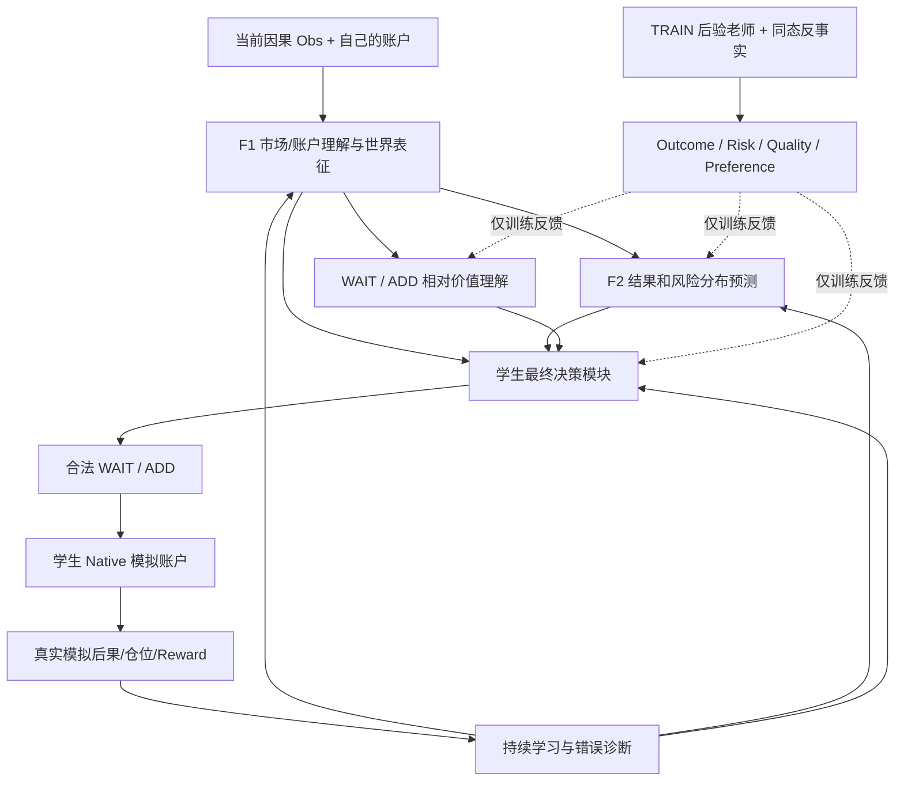
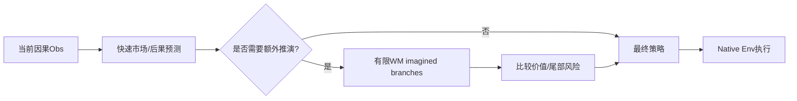
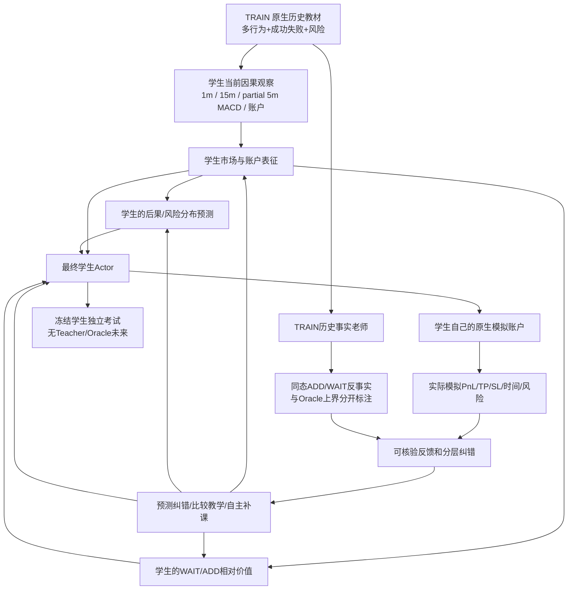

# FG-S3「会思考的交易学生」：可验证反事实教学与自主决策学习构想

> **Verified Counterfactual Learning & Deliberative Trading Student — Concept V1**  
> **形成日期：2026-10-22**  
> **文档性质：研究构想 / 目标架构 / 设计讨论存档；不是 Codex 执行任务书，也不是训练或效果验收报告。**  
> **基本原则：先把教育理念和完整信息流设计清楚，再讨论能否实现、怎样实现、需要多少资源以及是否有效。**

## 0. 为什么写下这份构想

原始目标始终是：**学生有基础、老师经验丰富、教材题型丰富；三者真正串起来；学生能够自己判断入场，经历自己操作的后果，在老师指导下持续改进。**

此前 FG-S3 已沿着 E-native Replay、Teacher、F1 World Model、F2 Quality Heads、F3 Quality Actor、F4 在线适配、独立考试推进。但从教育理念回头看，**模块分别存在，不等于学生已经把知识融会贯通**。尤其需要避免以下情况：

1. 学生只背诵严格Oracle的 WAIT/ADD 标签，没有理解为什么选择该动作。
2. 学生预测了TP、风险等结果，但预测与最终Actor决策之间没有实际信息通路。
3. 学生提出动作，但模拟账户长期由老师接管，学生无法经历自己真实的交易后果。
4. 老师利用后验未来给出的唯一正确答案被当作学生必须100%复制的答案。
5. World Model或虚构想象替代原生金融账户，形成无法验证的高收益。
6. 因为学生训练后可能表现不佳，就预先不设计完整的教学能力。

本文件尝试将现代机器学习的**预训练、监督示范、可验证反馈、偏好比较、反事实学习、世界模型、强化学习与按需推演**等思路重新组织为一套交易教育体系。**它是针对FG-S3提出的架构假说，不宣称这些机制已经在当前模型或GPT-6内部以相同形式实现，也不宣称一定提升收益。**

核心一句话：

> **教材提供经历，老师提供可核验的事实、相对价值和纠错反馈；学生先理解，再预测、比较、自己行动、承担模拟账户后果，逐渐掌握独立判断，而不是成为100%复刻后验Oracle的机器。**

## 1. 不变的业务目标与硬边界

- **任务**：方向由上游研究/行情识别提供；当前研究为合法做空方向上的入场择时，空仓时决策 `WAIT` 或 `ADD`。`ADD` 一批3手；唯一仓位TP +5点、SL −30点。
- **质量目标**：有优质机会才ADD；优先快速TP5、较小MAE、避免开仓后早期逆行10点，以及减少仓位长时间被占用；同时考察费用、净盈亏、权益回撤、漏过机会。
- **官方交易日**：夜盘与次日白盘按原交易所MarketClock计入官方交易日。日内完成TP是质量偏好，不凭空设定强制日终平仓。
- **金融真源**：真实历史市场数据 + 唯一原生金融Env执行规则；学生与老师分支使用同一撮合、手续费、仓位、保证金、Mask、Reward、TP/SL语义。这里的“真实”指**历史价格驱动的原生模拟账户**，不是交易所实盘成交，也不模拟订单市场冲击。
- **因果边界**：学生每次决策只能看到当时可见的1分钟行情、15分钟背景、部分可见的5分钟MACD、账户状态、合法动作Mask和自己的历史。历史未来只允许TRAIN老师侧生成事后标签、反事实评价和延迟反馈，不能进入实时特征/Actor。
- **模型职责**：神经网络可以学习市场未来的不确定结果，但不能重新发明固定的资金/清算/费用规则。原生账户负责交易事实，World Model的想象属于近似练习而不是财务真相。
- **科研与工程**：本文件先定义最终需要具备的教育能力；某能力是否进入正式训练、是否有效、是否满足准入，属于后续独立阶段。**不能把“尚未证明有效”当作“工程上不必设计或实现”。**

## 2. 三个角色，三种信息权限

| 角色 | 拥有什么 | 能做什么 | 不能做什么 |
|---|---|---|---|
| 教材（History & Experience） | 真实历史行情、官方时钟、不同合法账户经历、成功与失败案例 | 提供跨合约/跨阶段的自然、随机、延迟、老师示范和学生自采经历 | 将重复账户轨迹冒充独立市场；用事后标签污染学生Observation |
| 老师（Verified Tutor） | TRAIN行情完整后缀、同状态反事实分支及原生金融结算结果 | 教市场信息的含义，评估ADD后果与WAIT机会价值，比较学生与替代策略，指出预测错误和行动错误 | 在学生考试时提供未来提示；将后验最优一律当成可预测规律；在自主练习中永久接管学生动作 |
| 学生（Single Learning Agent） | 当前和历史因果观察、自己的模型、自己的模拟账户及过去反馈 | 理解市场、预测各动作后果与风险、比较等待价值、决定WAIT/ADD、自主承担模拟交易结果 | 看见未来K线、后验标签或未来收益；把老师的模拟账户当成自己的实际账户 |

**学生是否合格不等于盈利或100%复制老师。** 初始学生需要能使用基本K线/指标、理解账户状态、知道ADD/WAIT及TP/SL的意义，能够合法操作模拟环境；精确择时能力是后续学习目标。

### 2.1 两类老师职责，而不是两个必需神经网络

- **历史事实老师**：完整可验证的后验交易结果；可以告诉学生“如果你在此刻ADD，在这条已发生的历史路径中，持仓和退出如何演变”。它的权威是**事实/模拟规则**，不是可部署的先知。
- **可学习性/教学老师**：帮助识别哪些错误值得重点补课、哪些区别在当前可见信息下未必可预测、哪些预测已偏离校准。它可以是一套标签筛选、置信度、跨样本统计和课程调度机制，**不要求额外引入一个神秘的万能Teacher Model**。

这两种职责应分开，防止“事后答案正确”被误读为“实时学生必然应该知道”。

## 3. 一道完整交易题的教学协议

一题不应该只是 `(Obs, 正确WAIT/ADD)`，而应围绕**同一合法决策状态**组织多个可验证对象。

1. **出题**：给出当时可见的分时、15分钟背景、部分5分钟MACD、账户与Mask。
2. **学生先预测**：如果立即ADD，预测TP时间、MAE、前5/15分钟逆行、SL风险、持仓占用、交易质量；对继续WAIT预测后续机会价值与不确定性。学生的这些预测必须发生在读取后验答案之前。
3. **学生自主作答**：提出合法`WAIT/ADD`；若处于自主练习模式，这个动作**直接进入自己的原生模拟账户**，不由老师替换。
4. **学生承担后果**：后续市场推进；真实模拟仓位/权益/手续费/TP/SL/持仓时间由Native Env记账。预测和已经观察到的结果逐项对照。
5. **老师同态点评**：从相同决策前账户状态复制独立反事实分支，比较其它合法选择；给出后验事件、风险、质量差距、教师严格动作与可信度/有效位。
6. **分类纠错**：指出学生错在市场理解、后果预测、决策权衡还是偶然且难以预测的未来变化。
7. **更新能力**：针对不同错误更新市场表征、后果预测、WAIT/ADD价值理解及最终Actor。
8. **形成下一轮教材**：对学生真实错误做适度重放/补课，同时保留自然市场分布与稳定的评估边界。
9. **定期独立考试**：完整学生决策，老师不出现。考试后可以分析失败案例，但不能反过来修改已冻结的封存TEST。

### 3.1 例子：盈利但不是高质量入场

> **说明：以下数值为教学假设，不是真实FG809实验数据。**
>
> 学生从同一空仓状态选择ADD，12分钟TP5，但曾逆行11点；老师建议WAIT，独立分支在后续约定策略下等待3分钟再ADD，5分钟TP5，最大逆行2点。
>
> 老师的讲解不应只是“你错了，应当WAIT”，而应将错误拆成：对早期逆行低估、对继续等待机会低估；同时承认学生那一笔也是盈利交易，动作差距应按约定价值计算，不作为“和Oracle不同即严重错误”。

### 3.2 例子：学生WAIT，但错过机会

> 同一空仓状态：学生WAIT，不成交；老师分支立即ADD，4分钟TP5，最大逆行1点。老师指出可能错过质量较高的机会。但该例还需判断当时OBS是否包含足够可学习的线索；一个后验最佳机会不自动等于一个实时可识别机会。

## 4. 最重要的创新：从“后验最优答案”转向“可学的好决策”

严格Oracle在历史完整后缀上给出的ADD/WAIT选择是**事后最优参考**，而学生的输入只能包含当前可见历史。这两个目标在有随机性和不可观测因素的金融市场中并不相同。

考虑两个可观察状态几乎无法区分、但未来一涨一跌的日子。后验Oracle可以给出ADD与WAIT两个相反答案；学生不能保证仅凭已知行情区分这两条未来。若将它们都当作高置信度的“必须答对”标签，可能驱动模型记忆噪声或退化全WAIT。

因而需区分：

- **`HINDSIGHT_OUTCOME`**：某个历史价格路径上的真实/原生模拟后果；完全可核验。
- **`HINDSIGHT_PREFERENCE`**：同一历史后缀及已声明后续策略下两个动作哪个更好；是可核验的后验比较。
- **`PREDICTABLE_SIGNAL`**：仅根据当前可见信息，可以在多个合法历史样本上学习并校准的条件分布规律；这是学生目标，但只能通过数据和评估近似检验，而非由单一历史路径直接证明。
- **`STUDENT_DECISION`**：学生在不确定性下综合结果分布、等待价值与风险做出的独立动作。

**训练目标不是100%复制后验Oracle，而是逐步减少有意义、可学习且代价明显的决策错误。**

## 5. 原生同态反事实：学生账户不被老师接管

### 5.1 两种账户的职责

**学生主账户**是连续的、真正代表学生策略的原生模拟账户。它必须原样执行学生的合法动作；实际PnL、Reward、Mask、仓位与后续决策状态都从这条账户链产生。

**老师反事实账户**是从同一决策前状态派生的研究分支。它可以在该状态尝试替代动作并按约定后续策略推进。其结果用于解释选择的风险和价值，**绝不覆盖学生真实执行的动作，也不能作为学生账户实际盈利**。

必须复用唯一Native Env，并清楚记录：来源价格、相同起点账户hash、contract/official_day/cursor、分支动作、后续策略、评价区间、费用和重播身份。

### 5.2 WAIT具有后续策略，不能把WAIT当成单笔即时收益

ADD可开启真实TP/SL持仓链；WAIT意味着暂时保持空仓、下一分钟仍然有行动选择。因此不能直接给WAIT一个“以后Oracle选择最佳分钟”的值，再与学生立即ADD对比，却宣称差距由当前动作本身造成。

至少保留两类明确命名的比较：

1. **同一后续策略比较（教学动作边际）**：复制状态，第一动作分别是ADD和WAIT，之后使用相同且预先声明的合法策略规则推进。这更适合回答“单独改变本次选择带来什么”。
2. **老师最优后缀比较（Oracle上界）**：允许历史老师在TRAIN后缀内选择最优合法动作序列，表示后验上界/示范，但**不能当作学生应达到的实时可预测成绩**。

若两分支在后续时点产生不同账户状态，允许自然分歧；但比较必须从**同一初始账户状态**启动，不得用学生当前被套账户与老师已空仓账户的不同状态硬作同态比较。

### 5.3 教学事件的稀疏选择

不必在每一分钟为所有账户完整复制两条长期分支。优先选择：学生与老师明显不同意、学生预测置信度高但错误、ADD后早期逆行、长时间占仓、WAIT错过高质量机会、模型前后判断不一致等状态；同时保留一定自然采样，避免所有教学题都集中于“难例”。

**技术警告**：在固定历史行情和不考虑自身成交冲击的原生Env中，分支结果属于可复核的“历史路径反事实模拟”，并非真实世界中改变下单决策后的因果实盘实验。

## 6. 学生内部能力架构：观察、预测、比较、行动

**这是期望能力图，不预设唯一的张量连接。** 可行的工程实现仍需权衡：

- F2预测结果作为Actor特征，或作为经过门槛审核的有界Logit修正，还是参与可微的共同表征；不能因为当前存在一种旧融合公式就认定那是最佳设计。
- WAIT/ADD价值可以是独立的Distributional Q/Advantage Heads，也可能由F2联合预测分布推导、或作为Actor辅助损失；需明确可识别数据和不同后续策略的定义。
- 学生应保留F1→Actor的直接市场信息通路，避免一切决策完全受有偏F2预测束缚。
- 统一最终策略必须在真实Env执行、在线收集、想象训练和Teacher-free考试中具有一致的数学定义与明确的Mask/Gate；不能只给其中一个路径加预测增强。
- 神经网络可端到端联合微调，但每一阶段要知道谁受了哪类监督，不能以所有Head共同Loss下降代替知识传递。

## 7. 两种互补练习：广覆盖教材 + 学生个性化补课

### 7.1 静态教材覆盖面

E-native P0 WAIT、P1 ADD、P2随机低/中概率、P3延迟、P4合法后验Oracle轨迹，辅以原生训练案例中真实出现的快速TP、慢TP、SL30、5/15分钟逆行10点、超长水下、OTHER、账户资金不足、夜盘/官方日边界及右删失。

多行为轨迹能覆盖不同真实账户状态，但**同一合约/分钟因重复行为生成的多个账户不是多个独立市场样本**。保存`unique market`、`unique account state`、`optimizer exposure`三类分母；标签和后缀有效位不可缺失补零。

### 7.2 学生自主练习发现特有弱点

学生从自己策略的原生账户持续采集，经历自己的错误：过早ADD、长期被套、错过快速TP、错误风险预测、过度保守与无效等待。老师在后续事实足够后延迟点评，挑选典型状态形成**Mistake-Driven Curriculum（薄弱点专项补课）**。

专项补课与自然教材要同时存在：增加困难题的学习权重，不等于改变真实市场中困难题出现的频率。不能只训练“医生挑出来的异常病历”而忘记自然患者分布。

### 7.3 必须防止Teacher接管伪装学生实践

老师可以生成优秀示范，也可以在线事后监督；但正式记录的学生自主轨迹不能有“学生提出WAIT，老师替它ADD，却把结果记作学生经历”的情况。任何Teacher-owned、student-proposed、actual-executed字段必须分开。使用老师动作的示范账户是教学素材，不是学生自主考试成绩。

## 8. 三种主要纠错：学生错在什么地方？

| 错误类别 | 具体表现 | 主要教学反馈 | 对应学生能力 |
|---|---|---|---|
| **观察/表征错误** | 无法识别合法MarketClock、账户释放、1m/15m/partial MACD中有意义的变化 | 市场/账户状态重建、预测等可验证训练信号 | F1 |
| **结果理解错误** | 预测5分钟TP，实际上20分钟后才TP；或严重低估早期逆行 | 完整有效后验的时间/风险/分布预测误差 | F2 |
| **决策权衡错误** | 已预见高风险仍ADD；或预测有优质机会仍错误WAIT | 严格L2 + 同态反事实相对价值差 + 实际账户反馈 | 最终Actor/价值能力 |

第四种是**事后偶然差异**：历史单路径上老师显著更好，但当前观察未必包含可以重复学习的线索。这类样本不能简单强行赋予100%高置信度。老师需要用跨样本统计、预测可信度、足够独立样本和限制权重的方式处理；**不可声称可以逐条准确区分“噪声”与“可学习性”**。

## 9. 从模仿到价值比较：后验偏好不是绝对真理

训练中可以表示老师后验优势：

\[
\Delta Q_T(s; h, \pi_{cont}) = Q_T(s,\mathrm{ADD};h,\pi_{cont}) - Q_T(s,\mathrm{WAIT};h,\pi_{cont})
\]

其中`h`代表固定TRAIN历史路径和指定评价区间，`π_cont`代表预声明后续策略。**这只是该历史场景下的可核验教学比较**。

学生真正想近似的是在自己可见信息/记忆状态`b_t`下的期望（或风险敏感）动作价值：

\[
Q^{\pi}(b_t,a)=\mathbb{E}\left[\sum_{k\ge0}\gamma^k R_{t+k}\mid b_t,a_t=a,\pi\text{ thereafter}\right].
\]

可进一步学习价值差、事件概率/时间分布、低分位风险或不确定性，而不将单个未来样本当成确定概率；不要求数学上精确估计真实市场分布。

**建议教学损失不是单一的“和Oracle不同就扣1分”**，而是可能包括：

- F2可验证的结果/速度/风险/删失损失；
- F3严格动作监督与合法同态Pair监督；
- 对优势差明显的后验案例给予适当关注，对接近无差异案例弱监督；
- 对不确定、无效或缺少可复现信号的样本保守处理；
- 学生自身原生账户长期Quality TP回报与风险；
- 对学生行为造成的数据分布变化保持样本权重/来源审计。

上述是教学工具箱而非一个已固定的最终Loss公式；**不在构想阶段虚构权重、阈值或声称可证最优**。

## 10. 不确定性：不是永远WAIT，也不是假装知道未来

建议学生能表达：TP在5/15/30/60分钟内的概率、可能的时间分布、前5/15分钟逆行10点、SL30、持仓占用、未来WAIT机会价值及预测可信区间。不同事件彼此可重叠，概率不必加总为100%。

要区分：

1. **市场固有的不确定性**：同样可见状态以后可能涨也可能跌。
2. **模型知识不足**：新合约、罕见行情或分布变化时缺少可靠样本。

两者工程上不一定能准确拆开，但可通过多头校准、预测覆盖、OOD度量等辅助识别。未建立校准证据前，“模型输出0.7”不能被当作真实70%概率。

最终动作要考虑机会成本：风险高可能WAIT，**但并非风险永远存在就必须WAIT**。学生需要比较两个动作的质量分布及等待价值，而不是单纯追求零亏损/零交易。

## 11. 按需思考预算：远期可选研究能力

学生可以先用快速前向做判断；对预测不确定、ADD/WAIT价值接近、风险尾部复杂的状态，允许在世界模型中做有限次数的合法候选推演。

这不是现阶段必要能力，也不意味着越多想象越好：World Model长程漂移或Reward/Mask不准确时，会放大假想优势。**原生Env账户始终是已发生事实的权威；WM想象只能提供有误差的辅助决策。**

## 12. 完整教育阶段：一个学生，不是四个互不相关的模型

| 教育阶段 | 学生的主动活动 | 老师提供 | 需要形成的能力 |
|---|---|---|---|
| **A 基础教育** | 阅读历史因果行情，认识账户与开平操作后果 | 可验证市场、账户及动作规则 | F1市场理解与操作基础；不要求盈利 |
| **B 后果理解** | 先预测立即ADD可能的结果与风险 | 真实后缀、TP/SL/MAE/时间/删失答案 | F2预测与不确定性认知 |
| **C 比较决策** | 预测ADD与WAIT的相对价值，作出自己的合法选择 | 严格L2和同态反事实比较 | 综合F1/F2/价值后的F3决策能力 |
| **D 自主实习** | 用自己的账户连续WAIT/ADD，经历结果与失误 | 延迟、针对性的点评与补课；可受控RL | F4在线适配与学习能力 |
| **E 独立考试** | 完全自主使用训练好的学生内部能力 | 老师不输入任何未来/动作 | Teacher-free完整闭环表现 |

阶段可分开实施、冻结、恢复、参数接续；**最终学生必须是同一个连续继承、能够共同使用这些知识的Agent**。F1/2/3/4仅是课程和模型能力标签，不应该限制教学逻辑。

## 13. 目标闭环架构图

补充说明：该图中的循环代表随时间和训练更新逐渐形成的教育循环，**不是单次前向传播时老师将未来作为网络输入**。训练标签、原生账户反馈、推理信息必须在数据结构与运行权限上分离。

## 14. 方案需要回答但刻意尚不拍板的问题

本文件**不是**最终工程施工图。以下分歧必须未来逐项讨论并明确，不得由Codex擅自猜测：

1. **内部知识融合**：F2预测与WAIT价值信息是输入Actor、共享潜在表征、还是通过独立Gate作有界修正？最终策略是否需要基础Actor与增强Actor两条兼容的可审计路径？
2. **WAIT价值定义**：使用学生当前策略、冻结参考策略还是老师后验最优后续策略；多长评价区间；如何正确处理持仓遮蔽、roll、右删失、官方日。
3. **教师案例置信度**：如何估计哪些后验优势值得强监督，而不声称“某单一样本肯定可预测”；如何防止偏好学习过拟合未来偶然性。
4. **F1操作基础**：哪些账户/动作基础知识由原生Env硬规则实现，哪些需要F1的可训练世界表征；不应为了“会操作”要求基础Actor先盈利。
5. **F2事件表示**：四个现有Heads能否表达所需的速度分布、尾部风险、删失、不确定性；是否需要新Head、怎样兼容已有训练数据。
6. **Teacher与学生账户接线**：哪些分支用于反事实教学、哪些反事实需全流程冷恢复；避免在线Student真实账户被老师动作替换。
7. **F4真实/想象一致性**：World Model想象动作与真实Env动作如何使用同一学生策略；何时才允许训练时利用反事实优势，怎样防止Teacher未来泄漏。
8. **自适应教材采样**：学生错题回放、自然经验、P0–P4分别占多少；如何避免过度重复特殊题型和过拟合单合约。
9. **工程边界**：当前双仓已有多少能力能够原样复用，哪些仅有模型参数没有前向决策路径；等设计同意后再做严格接口Review。
10. **最小工程验收**：能否用构造的合法病例证明“学生提动作→自己的账户执行→老师在同状态形成可验证比较→纠正预测和决策→冻结学生独立动作”完整闭环。工程完整性不以真实训练收益为前置。

**目前只存档构想，不自动生成Codex开发清单、不启动正式训练、不调整现有Reward/金融规则、不读取封存TEST。**

## 15. 判断“工程按设计完成”与“训练真的有效”的区别

**概念设计完成**：本文件明确三角色、知识路径、学生自主账户、后验教师权限、相对价值/不确定性与闭环纠错；未定问题明示而不伪装成规格。

**工程架构完成（未来）**：所有设计选定的关键输入/输出真实实现并可运行，不存在“F2已训好但决策完全不能使用”“Teacher控制账户却声称学生独立操作”“考试用的不是学生训练的策略”等断点；构造场景中的信息因果与原生账户准确，冷恢复后行为一致。

**正式训练完成（未来）**：F1/F2/价值学习/Actor/在线练习在经过认证的真实TRAIN教材上实际发生参数更新，来源与权限可验。

**有效性研究（未来）**：在合法独立DEV与最终受控TEST上检验是否减少重大入场错误、提高快速TP质量、控制MAE/SL、避免AllWAIT和盲目ADD、跨合约与市场环境泛化；结果可能是不成功、部分成功或尚无定论，不反过来取消已确认的工程概念。

## 16. 用来回看此方案的一句话

> **培养的不是能背出未来答案的学生，而是一个具有市场基础、能自主操作模拟账户、会预测结果与风险、理解等待机会价值、接受老师可核验点评，并不断改进决策的学生。**
>
> **老师的使命不是永远替学生交易，而是让自己最终能够退出。**

---

### 研究来源与灵感边界

- `teacher_student.md` 早期讨论：最初Single3 Replay的覆盖问题、E+Tutor Full 1M的实际AllWAIT教训、师生与教材比喻的来源。
- 本轮后续讨论确认的方向：真实自主账户、原生同态反事实、Prediction与Decision相互连接、错误严重程度、不确定性、按薄弱点补课、有限世界模型想象和Teacher-free考试。
- 方法灵感：公开的语言模型预训练/监督微调/偏好反馈/强化学习研究，以及世界模型、反事实和分布式价值学习思想。**本文没有声称复刻某一代ChatGPT的内部训练流程，也没有为FG-S3这些新组合提供已验证实验效果。**

*版本管理建议：保留本文V1原样作为理念存档。未来如需扩充，另起“V2讨论稿/架构决策记录”，不要为了工程可实现性直接改写这份原始构想。*
